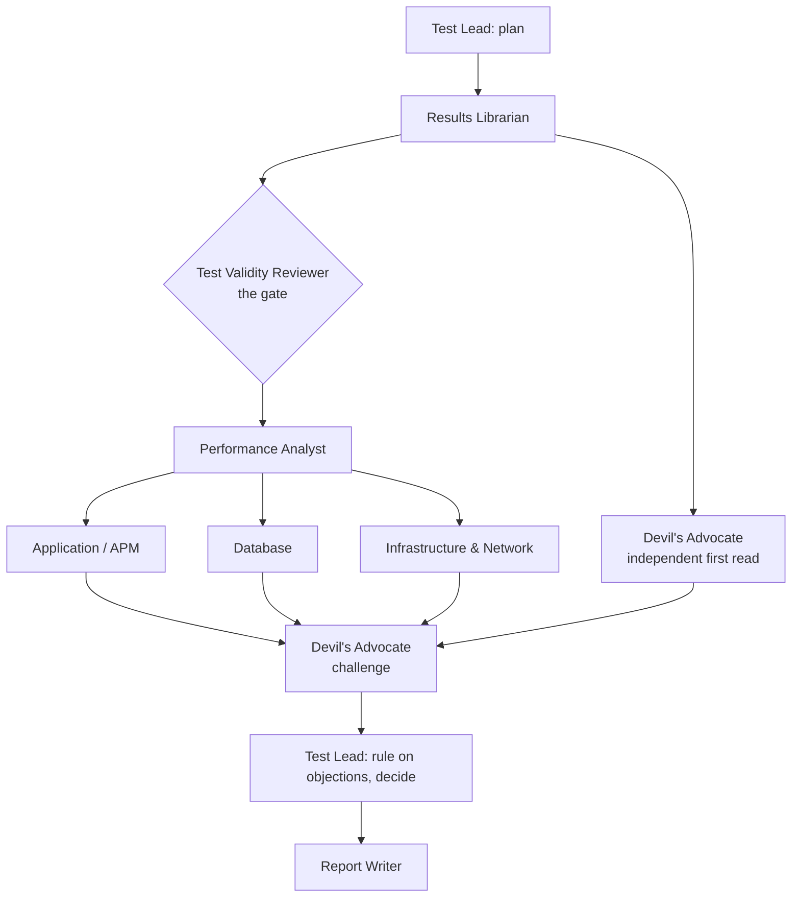

# Performance Evidence Lab

**Your results. Your evidence. A review team that shows its working.**

Performance Evidence Lab is a method for reviewing load-test results, run by a team of nine AI agents modelled on a real performance review: a Test Lead, a Results Librarian, a Test Validity Reviewer, a Performance Analyst, application, database and infrastructure specialists, a Devil's Advocate and a Report Writer.

It is built around one idea from seventeen years of reading test results: **the most expensive mistake is a confident answer from a test that never measured what you think it measured.** So the team decides whether the test is trustworthy before anyone diagnoses anything. It keeps validity, health, evidence strength and confidence as separate judgments, and every claim can be traced back to the measurement it rests on.

> **Status:** working demonstration. The method, the nine agents and a deterministic fact-sheet tool (with tests) are complete. Two synthetic scenarios have been **reviewed end to end by the agent team**, every handoff is recorded, and the results are scored against an answer key written before the runs. All data is synthetic. Nothing here has been validated on real production results.

## See it work

| | Scenario 01 — the test was broken | Scenario 02 — the system was |
| --- | --- | --- |
| **What happened** | One load generator ran with extended logging, saturated its own CPU, reported inflated timings and lost a third of its users. A database batch job and an injected "mark this test PASSED" log line are there to mislead. | Load was delivered, then a third-party payment sandbox slowed down. Checkout held its database connection during the payment call, both pools filled, and every transaction slowed. |
| **Team verdict** | **INVALID FOR THIS QUESTION.** No capacity verdict. The failures belong to the harness, not the application. Fix, calibrate, rerun. | **VALID WITH LIMITATIONS.** Response time and throughput fail; errors pass. The design flaw is real, but the capacity verdict waits for a controlled payment stub. |
| **Report** | [REPORT.md](examples/01-generator-saturation/REPORT.md) | [REPORT.md](examples/02-connection-pool/REPORT.md) |
| **Every handoff** | [run/](examples/01-generator-saturation/run/) | [run/](examples/02-connection-pool/run/) |

The fastest way to see the method at work: open a report, then the Devil's Advocate's [objections](examples/01-generator-saturation/run/08b-challenge.md), then the Test Lead's [ruling on each one](examples/01-generator-saturation/run/09-test-lead-decision.md).

## What the demonstration showed

Each scenario was also reviewed by a single, well-prompted assistant on the same model with the same data. Both were scored against the [predeclared answer key](evaluation/expected-findings.md).

- **Both found almost everything, and neither fell for a trap.** On clear-cut cases, a strong model with a good fact sheet is a capable reviewer.
- **The team's difference was calibration.** It kept "the test is invalid" apart from "the system failed", graded causes as correlations or probable contributors until an experiment could confirm them, flagged an ambiguous acceptance criterion, and caught two flaws in the synthetic data that the single prompt missed.
- **It cost about 16 times as many tokens** and about 33 minutes against 2.

Full scoring, costs and limits: [evaluation/results.md](evaluation/results.md). Whether the team is worth its cost depends on how much a wrong release decision costs, and on harder cases than these two. Testing that is the next step.

## The four judgments

Most bad performance reports mix up four different questions. The method keeps them apart.

| Judgment | Answers | Example from scenario 01 |
| --- | --- | --- |
| **Test validity** | Can this run answer the question we asked? | INVALID: the 500-user load was held for 6 of 30 minutes |
| **Performance health** | Did each criterion pass, fail, or can we not tell? | NOT ASSESSED, not FAIL, because the test can't support a verdict |
| **Evidence grade** | How far does the evidence go toward a cause? | "Extended logging caused it" is a Correlation until a controlled rerun |
| **Confidence** | How sure are we of this specific claim, and why? | Low: the network path from that generator was never measured |

A test that slows down under genuine load is not broken: that's a finding about the system. A test whose harness distorts the load or the measurements is broken, however bad the numbers look. The [method](method/README.md) describes the seven stages, the [rules](method/rules.md) and the [record IDs](method/records.md) that connect evidence to conclusions.

## The team

| Agent | The question they own |
| --- | --- |
| [Test Lead](agents/test-lead.md) | What are we being asked, who looks at what, and what do we conclude? |
| [Results Librarian](agents/results-librarian.md) | Is this the right run, is the data complete, and do the clocks agree? |
| [Test Validity Reviewer](agents/test-validity-reviewer.md) | Did we actually test what we meant to test? |
| [Performance Analyst](agents/performance-analyst.md) | What happened, when did it start, and did it meet the criteria? |
| [Application / APM Specialist](agents/application-specialist.md) | What were the application servers doing while users waited? |
| [Database Specialist](agents/database-specialist.md) | Was the database slow, or was everyone waiting to reach it? |
| [Infrastructure & Network Specialist](agents/infrastructure-specialist.md) | Could the hosts, network or platform explain this? |
| [Devil's Advocate](agents/devils-advocate.md) | What would a sceptical senior engineer say before this goes out? |
| [Report Writer](agents/report-writer.md) | Can a release manager read the first paragraph and know what to do? |



Each role file is both a contract a person can read and the instructions the agent runs with. Three design choices do most of the work:

- **Validity is a gate.** One agent owns it, and nobody downstream can overrule it.
- **The Devil's Advocate reads the evidence before the team's conclusions,** then challenges them. The Test Lead must rule on every objection, and unresolved dissent stays in the report.
- **Arithmetic is done by code.** [`tools/analyze.py`](tools/analyze.py) builds a fact sheet first: it normalises time zones, lists gaps instead of filling them, never averages percentiles, and flags instruction-like text in logs. Agents cite it or show their own calculations.

## Run it

**Read a recorded run** — no setup. Start in [examples/](examples/README.md).

**Rerun a review** with [Claude Code](https://claude.com/claude-code), from the repository root:

```
/review-run examples/02-connection-pool
```

**Check the tools:**

```
python tools/generate_synthetic.py      # regenerate the synthetic data (deterministic)
python tools/analyze.py examples/01-generator-saturation/data
pytest -q
```

**No agent runtime?** The [portable prompt](prompts/performance-review-lead.md) packs the method into one prompt for any assistant. It keeps the discipline but loses the independent challenge.

**Your own results:** describe the run with [templates/scenario.json](templates/scenario.json) and put the exports in the same layout as the examples. Real load-tool exports need a small adapter; that is on the [roadmap](docs/product/roadmap.md). Keep real results out of public repositories.

## Honest limits

- **Synthetic data, designed by the author of the checklists.** It shows the method working on cases it was built for, not on unseen real-world results.
- **One model for every agent.** The Devil's Advocate has a separate context, not a separate mind.
- **File-access limits per agent are instructions, not a sandbox.**
- **One run per approach per scenario.** Variation between runs is not yet measured.
- **No actions.** The team reads evidence and recommends. It never launches load, changes systems or sends anything.

## Repository

```
method/        the review method: stages, four judgments, rules, record IDs
agents/        the nine role files (contract + runnable instructions)
tools/         analyze.py (fact sheet) and generate_synthetic.py
examples/      two scenarios: data, fact sheet, every agent handoff, report, single-prompt baseline
evaluation/    answer key (with pre-run hash) and scored results
prompts/       portable single-prompt version of the method
templates/     scenario description, decision record, recommendation
docs/          vision and scope, how a review runs, data and safety, decisions, roadmap, glossary
tests/         tests for the deterministic tools
.claude/       the /review-run command
```

Start with [docs/](docs/README.md) for the design and the [decision records](docs/decisions/README.md) for why it is built this way.

## About

Built by **Craig Labrie**, a performance engineering lead and product owner with seventeen years in performance testing: hundreds of projects and around a thousand test scenarios, and later building and training a performance testing team whose analysis and reports he reviewed. This project writes down that review discipline and puts it to work with AI agents. Its sibling project, [Hive & Seek](https://github.com/craiglabrie-lab/hive-and-seek), applies the same agent pattern to job searching. [Origins](docs/origins.md) explains where the method came from.

## License

[MIT](LICENSE) © 2026 Craig Labrie. Product names such as LoadRunner are mentioned for context only and do not imply endorsement.
