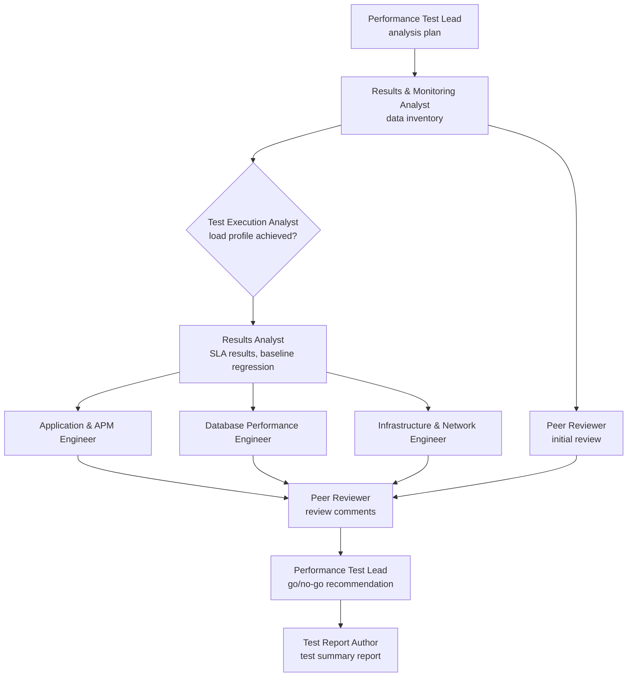
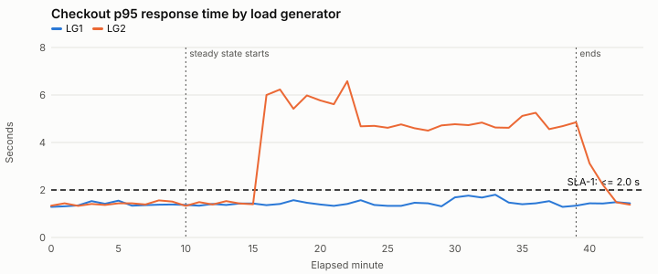

# Performance Evidence Lab

**Performance Evidence Lab** is an agentic workflow for analyzing performance test results. A Performance Test Lead agent orchestrates eight specialist sub-agents through the same steps an experienced performance team follows:

1. Validate the test execution.
2. Analyze the results against the SLAs and the baseline run.
3. Isolate the bottleneck across the application, database and infrastructure tiers.
4. Peer-review the findings.
5. Deliver a test summary report with a go/no-go recommendation and a retest plan.

It is built on a lesson from 17 years of performance testing: **before you diagnose a bottleneck, confirm the test produced the load profile it was designed for.**

## Status

| Part | Status |
| --- | --- |
| Analysis workflow, nine agent role files, Claude Code sub-agent definitions | Implemented |
| Deterministic tooling: transaction summary, p90/p95/p99, errors by type, graphs, baseline comparison, Utilization Law headroom (with tests) | Implemented |
| Three synthetic test runs: a baseline and two scenarios, with an answer key written in advance | Implemented |
| Recorded agent runs of the current agents, scored against the answer key | Planned: next stage |
| Handoff schema (draft JSON Schema included), orchestrator with checkpoints and human sign-off, agent tool contracts, cost and model routing, evaluation harness, multi-run regression tracking | Concept: [design documents](docs/concepts/README.md), each labeled as not yet implemented |

All data is synthetic. Nothing has been tested on production results. The [persona review](docs/reviews/2026-11-persona-review.md) records how the repository was reviewed by a performance engineer, a performance tester and an AI engineer, and the status of each point.

## Why an agentic workflow

AI can read a full set of load test results in seconds and write a polished report. Common mistakes in those reports:

- a confident root cause from a test whose load generator was saturated;
- a capacity verdict from a run that lost a third of its Vusers;
- a "regression" against the baseline that is really a broken test;
- "probable database contention" that the database's own metrics contradict.

The workflow prevents these the way a good performance team does:

- it splits the analysis into defined roles;
- it validates the test execution before any bottleneck analysis;
- each engineer identifies or eliminates their own tier with its own metrics;
- the findings are peer-reviewed before they go out.

Deterministic tooling does every calculation, so no agent has to do math on its own.

## The agents

| Agent | Responsibility |
| --- | --- |
| [Performance Test Lead](agents/performance-test-lead.md) (orchestrator) | Confirms test type, objective and NFRs; assigns tier reviews; resolves review comments; issues the go/no-go recommendation for a human approver |
| [Results & Monitoring Analyst](agents/results-monitoring-analyst.md) | Collects results and monitoring, aligns time zones, lists monitoring gaps, records execution metadata, checks the baseline run is available |
| [Test Execution Analyst](agents/test-execution-analyst.md) | Validates the execution: load profile achieved, load generator utilization, runtime settings, script validity, test data, environment parity |
| [Results Analyst](agents/results-analyst.md) | Transaction summary, p90/p95/p99, throughput, errors by type, degradation onset, baseline regression, SLA results |
| [Application & APM Engineer](agents/application-apm-engineer.md) | App tier: threads, connection pools, GC, outbound calls, trace breakdown, headroom |
| [Database Performance Engineer](agents/database-engineer.md) | Query response times, wait events, locks, sessions, batch jobs, headroom |
| [Infrastructure & Network Engineer](agents/infrastructure-network-engineer.md) | Host utilization and headroom, load balancer, network, platform limits |
| [Peer Reviewer](agents/peer-reviewer.md) (reviewer agent) | Forms a view from the data first, then writes review comments on the team's findings |
| [Test Report Author](agents/test-report-author.md) | Test summary report: executive summary, transaction summary, graphs, findings, retest plan, approval block |



Each role is a Claude Code sub-agent ([`.claude/agents/`](.claude/agents/)) with its own context and a fixed tool list. Results pass forward as numbered handoff files. Every role file in [`agents/`](agents/README.md) is both a readable role description and the instructions the agent runs with.

## The four results in every test summary

| Result | Values | Example: test run 01 |
| --- | --- | --- |
| **Test validity** | Valid · Valid with limitations · Invalid | Invalid: load profile not achieved. LG2 saturated at minute 16, and from minute 17 running Vusers fell from 500 to 330. |
| **SLA results** | Pass · Fail · Not evaluated | Not evaluated: the test cannot support a capacity result, so the SLAs are not marked Fail. |
| **Root-cause status** | Symptom · Correlated metric · Suspected bottleneck · Confirmed root cause | Extended logging on LG2 is a suspected bottleneck in the test harness until a retest with matched logging confirms it. |
| **Confidence** | High · Medium · Low, with a reason | Depends on monitoring coverage, for example whether the network path from the load generator was monitored. |

A system that slows down under the planned load does not make a test invalid; that is a result about the system. A test harness that distorts the load or the measurements does make it invalid, however bad the numbers look. The [analysis workflow](method/README.md) covers the seven stages and the [analysis rules](method/rules.md).

## What the tooling produces

Before any agent runs, [`tools/analyze.py`](tools/analyze.py) builds a computed results summary from the raw exports. It includes:

- **Test run overview**: test type, build, baseline run, environment parity, scripts, test data, runtime settings.
- **Transaction summary**: count, passed, failed, error %, and min, average, p90, p95, p99, max and standard deviation per transaction and load generator.
- **Graphs**: running Vusers, throughput, checkout p95 and errors over time.
- **Baseline comparison**: p90, p95 and p99 change per transaction against the baseline run, with a regression threshold.
- **Errors by type**: client timeouts, HTTP 5xx and content check failures.
- **Capacity**: Utilization Law service demand and throughput at 80% CPU for each tier.
- **Load profile by minute**: scheduled and running Vusers, TPS, error rate, and implied cycle time (Little's Law).
- **Data inventory**: coverage, monitoring gaps, time zone normalization, and flagged prompt-injection text.



*Test run 01: LG2's measured checkout p95 jumps above the 2.0 s SLA at minute 16 while LG1, hitting the same application, stays under it. The problem is on the load generator, not the system.*

## Example test runs

| | Test run 01: load generator saturation | Test run 02: connection pool exhaustion |
| --- | --- | --- |
| **In the data** | LG2 runs with extended logging, saturates its own CPU, reports inflated response times and loses Vusers to abort-on-error. A database batch job, a baseline comparison that looks like a regression, and a prompt-injection line in the generator log are there to mislead. | The load profile is achieved, then the third-party payment sandbox slows down. Checkout holds its DB connection during the payment call, both connection pools are exhausted, and every transaction slows. |
| **Expected result** | Test invalid. No capacity result and no regression verdict. Fix the test harness and retest. | Valid with limitations. SLA-1 and SLA-2 fail, SLA-3 passes. Suspected bottleneck: DB connection held across the payment call. |

Both are compared against [test run 00](examples/00-baseline/), the accepted baseline on the previous build. The expected findings are in a [written-in-advance answer key](evaluation/expected-findings.md). Its hash is committed before any run, so the key cannot be adjusted to match the results.

## Run it

Analyze a test run with [Claude Code](https://claude.com/claude-code), from the repository root:

```
/review-run examples/02-connection-pool
```

Check the deterministic tooling:

```
python tools/generate_synthetic.py      # regenerate the synthetic test runs
python tools/analyze.py examples/01-generator-saturation/data --charts /tmp/charts
pytest -q
```

**Without an agent runtime:** the [single-prompt version](prompts/performance-review-lead.md) packs the workflow into one prompt for any AI assistant. You lose the separate agent contexts and the independent peer review.

**Your own results:** describe the test run with [templates/scenario.json](templates/scenario.json) and use the same file layout as the examples. Real tool exports need a small adapter; adapters are on the [roadmap](docs/product/roadmap.md). Keep real results out of public repositories.

## Limitations

- **Synthetic test runs.** The same author designed the test runs and the agent checklists, so they show the workflow working on cases it was designed for.
- **One model for every agent.** The Peer Reviewer has its own context, not its own model.
- **The orchestrator is a prompt, not code.** There are no checkpoints or resume yet (see the [orchestrator concept](docs/concepts/orchestrator.md)).
- **Tool lists are enforced; file-level limits are not.** Each sub-agent's input files are instructions, and Python can read any file.
- **Analysis only.** The agents never start a load test, change a system or send anything. The go/no-go recommendation goes to a human release approver.

## Repository

```
method/           analysis workflow: stages, test summary results, rules, record IDs
agents/           the nine agent role files
.claude/agents/   Claude Code sub-agent definitions (one per role, fixed tool lists)
.claude/commands/ the /review-run orchestration command
tools/            analyze.py (computed results summary and graphs) and generate_synthetic.py
examples/         baseline run 00 and test runs 01 and 02: data, computed results summary, graphs
evaluation/       answer key and its pre-run hash
schemas/          draft handoff JSON Schema and example (concept)
prompts/          single-prompt version of the workflow
templates/        test run description, go/no-go recommendation, recommendation
docs/             vision and scope, how the workflow runs, data and safety, decisions, concepts, reviews, roadmap, glossary, style guide
tests/            tests for the deterministic tooling
```

## About

Built by **Craig Labrie**, a performance engineering lead and product owner with 17 years in performance testing: more than 200 performance test projects and about 1,000 test scenarios, and later building and leading a performance testing team whose test scenarios, analysis and reports he reviewed. Its sibling project, [Hive & Seek](https://github.com/craiglabrie-lab/hive-and-seek), applies the same agent pattern to job searching. [Origins](docs/origins.md) describes where the workflow came from.

## License

[MIT](LICENSE) © 2026 Craig Labrie.
