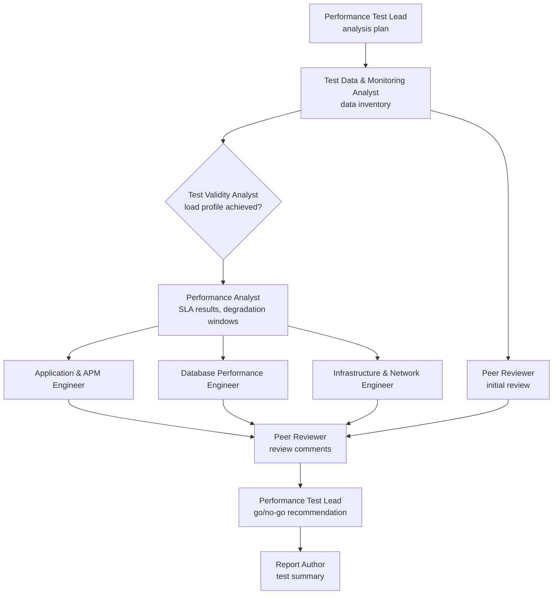

# Performance Evidence Lab

**Performance Evidence Lab** is an agentic workflow for analyzing performance test results. A Performance Test Lead agent orchestrates eight specialist sub-agents through the same steps an experienced performance team follows:

1. Validate the test.
2. Analyze the results against the SLAs.
3. Isolate the bottleneck across the application, database and infrastructure tiers.
4. Peer-review the findings.
5. Deliver a test summary with a go/no-go recommendation and a retest plan.

It is built on a lesson from 17 years of performance testing: **before you diagnose a bottleneck, confirm the test produced the load profile it was designed for.**

> **Status:** the workflow, the nine agent role files, the deterministic tooling (with tests) and two synthetic test runs are complete. Recorded agent runs and scored results for the current agents are the next stage. All data is synthetic, and nothing has been tested on production results.

## Why an agentic workflow

AI can read a full set of load test results in seconds and write a polished report. Common mistakes in those reports:

- a confident root cause from a test whose load generator was saturated;
- a capacity verdict from a run that lost a third of its Vusers;
- "probable database contention" that the database's own metrics contradict.

The workflow prevents these the way a good performance team does. It splits the analysis into defined roles, checks test validity before any bottleneck analysis, has each engineer identify or eliminate their own tier with its own metrics, and peer-reviews the findings before they go out. Deterministic tooling does every calculation, so no agent has to do math on its own.

## The agents

| Agent | Responsibility |
| --- | --- |
| [Performance Test Lead](agents/performance-test-lead.md) (orchestrator) | Confirms the test objective and SLAs, assigns engineers, resolves review comments, issues the go/no-go recommendation |
| [Test Data & Monitoring Analyst](agents/test-data-analyst.md) | Data inventory, time alignment, monitoring gaps, prompt-injection text in logs |
| [Test Validity Analyst](agents/test-validity-analyst.md) | Load profile achieved, load generator health, runtime settings, script errors versus server errors |
| [Performance Analyst](agents/performance-analyst.md) | Response times, throughput, errors, onset of degradation, SLA results |
| [Application & APM Engineer](agents/application-apm-engineer.md) | App servers, thread and connection pools, GC, outbound calls, APM traces |
| [Database Performance Engineer](agents/database-engineer.md) | Query response times, wait events, locks, sessions, batch jobs |
| [Infrastructure & Network Engineer](agents/infrastructure-network-engineer.md) | Host headroom, load balancer, network, platform limits |
| [Peer Reviewer](agents/peer-reviewer.md) (reviewer agent) | Reviews the data first, then the team's findings, and writes review comments |
| [Report Author](agents/report-author.md) | Test summary: executive summary, findings, tiers eliminated, retest plan |



Each sub-agent runs with its own context and passes its results forward in a numbered handoff file. Every role file is both a readable role description and the instructions the agent runs with.

## The four results in every test summary

| Result | Values | Example: test run 01 |
| --- | --- | --- |
| **Test validity** | Valid · Valid with limitations · Invalid | Invalid: load profile not achieved. 500 Vusers were held for 6 of the 30 planned steady-state minutes. |
| **SLA results** | Pass · Fail · Not evaluated | Not evaluated: the test cannot support a capacity result, so the SLAs are not marked Fail. |
| **Root-cause status** | Symptom · Correlated metric · Suspected bottleneck · Confirmed root cause | Extended logging on LG2 is a suspected bottleneck in the test harness until a retest with matched logging confirms it. |
| **Confidence** | High · Medium · Low, with a reason | Depends on monitoring coverage, for example whether the network path from the load generator was monitored. |

A system that slows down under the planned load does not make a test invalid; that is a result about the system. A test harness that distorts the load or the measurements does make it invalid, however bad the numbers look. The [analysis workflow](method/README.md) covers the seven stages and the [analysis rules](method/rules.md).

## Example test runs

| | Test run 01: load generator saturation | Test run 02: connection pool exhaustion |
| --- | --- | --- |
| **In the data** | LG2 runs with extended logging, saturates its own CPU, reports inflated response times and loses Vusers to abort-on-error. A database batch job and a prompt-injection line in the generator log are there to mislead. | The load profile is achieved, then the third-party payment sandbox slows down. Checkout holds its DB connection during the payment call, both connection pools are exhausted, and every transaction slows. |
| **Expected result** | Test invalid. No capacity result. Fix the test harness and retest. | Valid with limitations. SLA-1 and SLA-2 fail, SLA-3 passes. Suspected bottleneck: DB connection held across the payment call. |

The expected findings are in a [written-in-advance answer key](evaluation/expected-findings.md). Its hash is committed before any run, so the key cannot be adjusted to match the results. Recorded runs of the current agents, scored against the key and compared with a single AI assistant on the same data, are the next stage.

## Run it

Analyze a test run with [Claude Code](https://claude.com/claude-code), from the repository root:

```
/review-run examples/02-connection-pool
```

Check the deterministic tooling:

```
python tools/generate_synthetic.py      # regenerate the synthetic test runs
python tools/analyze.py examples/01-generator-saturation/data
pytest -q
```

**Without an agent runtime:** the [single-prompt version](prompts/performance-review-lead.md) packs the workflow into one prompt for any AI assistant. You lose the separate agent contexts and the independent peer review.

**Your own results:** describe the test run with [templates/scenario.json](templates/scenario.json) and use the same file layout as the examples. Real tool exports need a small adapter; adapters are on the [roadmap](docs/product/roadmap.md). Keep real results out of public repositories.

## Limitations

- **Synthetic test runs.** The same author designed the test runs and the agent checklists, so they show the workflow working on cases it was designed for.
- **One model for every agent.** The Peer Reviewer has its own context, not its own model.
- **Each agent's file inputs are instructions, not a sandbox.**
- **Analysis only.** The agents never start a load test, change a system or send anything.

## Repository

```
method/        analysis workflow: stages, test summary results, rules, record IDs
agents/        the nine agent role files
tools/         analyze.py (computed results summary) and generate_synthetic.py
examples/      two synthetic test runs with their computed results summaries
evaluation/    answer key and its pre-run hash
prompts/       single-prompt version of the workflow
templates/     test run description, go/no-go recommendation, recommendation
docs/          vision and scope, how the workflow runs, data and safety, decisions, roadmap, glossary, style guide
tests/         tests for the deterministic tooling
.claude/       the /review-run command
```

## About

Built by **Craig Labrie**, a performance engineering lead and product owner with 17 years in performance testing: more than 200 performance test projects and about 1,000 test scenarios, and later building and leading a performance testing team whose test scenarios, analysis and reports he reviewed. Its sibling project, [Hive & Seek](https://github.com/craiglabrie-lab/hive-and-seek), applies the same agent pattern to job searching. [Origins](docs/origins.md) describes where the workflow came from.

## License

[MIT](LICENSE) © 2026 Craig Labrie.
