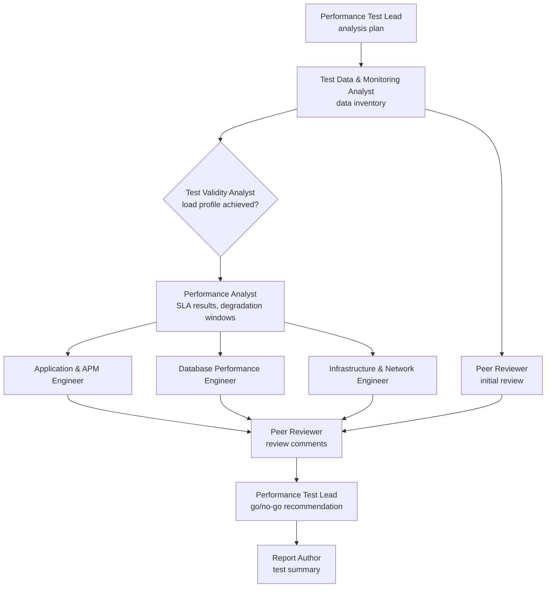

# Agents

Nine agents, modeled on the people a performance team brings into a results analysis. The Performance Test Lead orchestrates the work; the others run as sub-agents, each with its own context, and pass their results forward as handoff files.

Each file below is both the **role description** a person can read and the **instructions the agent runs with**. There is no separate prompt.

| Agent | Responsibility | Writes |
| --- | --- | --- |
| [Performance Test Lead](performance-test-lead.md) (orchestrator) | Confirms the test objective and SLAs, assigns engineers, resolves review comments, issues the go/no-go recommendation | `01-analysis-plan.md`, `09-go-no-go.md` |
| [Test Data & Monitoring Analyst](test-data-analyst.md) | Data inventory, time alignment, monitoring gaps, prompt-injection text | `02-data-inventory.md` |
| [Test Validity Analyst](test-validity-analyst.md) | Load profile achieved, load generator health, runtime settings, script errors | `03-test-validity.md` |
| [Performance Analyst](performance-analyst.md) | Response times, throughput, errors, onset of degradation, SLA results | `04-results-analysis.md` |
| [Application & APM Engineer](application-apm-engineer.md) | App servers, thread and connection pools, GC, outbound calls, APM traces | `05-application-apm.md` |
| [Database Performance Engineer](database-engineer.md) | Query response times, wait events, locks, sessions, batch jobs | `06-database.md` |
| [Infrastructure & Network Engineer](infrastructure-network-engineer.md) | Host headroom, load balancer, network, platform limits | `07-infrastructure-network.md` |
| [Peer Reviewer](peer-reviewer.md) (reviewer agent) | Initial review from the data alone, then review comments on the team's findings | `08a-initial-review.md`, `08b-peer-review.md` |
| [Report Author](report-author.md) | Test summary with executive summary, findings and retest plan | `TEST-SUMMARY.md` |

## Workflow

## Design choices

- **Test validity comes first, and one agent owns it.** No agent downstream can turn an invalid test into a valid one. The Performance Test Lead can record a disagreement, not override it.
- **The Peer Reviewer reviews the data before the team's analysis.** Its first run sees only the data and the data inventory. Its second run reviews the team's findings. The Performance Test Lead must resolve every review comment.
- **The three engineers run in parallel,** and each can eliminate its own tier with its own metrics.
- **Math is done by deterministic tooling.** [`tools/analyze.py`](../tools/analyze.py) produces the computed results summary before any agent runs.

## Boundaries

- Changing the set of agents is a design decision ([ADR-0002](../docs/decisions/0002-nine-agent-team.md)).
- The Performance Test Lead decides which engineers a given test run needs.
- No agent changes a system, starts a load test, sends anything or publishes data. The agents analyze results and make recommendations.

All agents follow the [analysis workflow](../method/README.md), and everything is written to the [style guide](../docs/style-guide.md).
