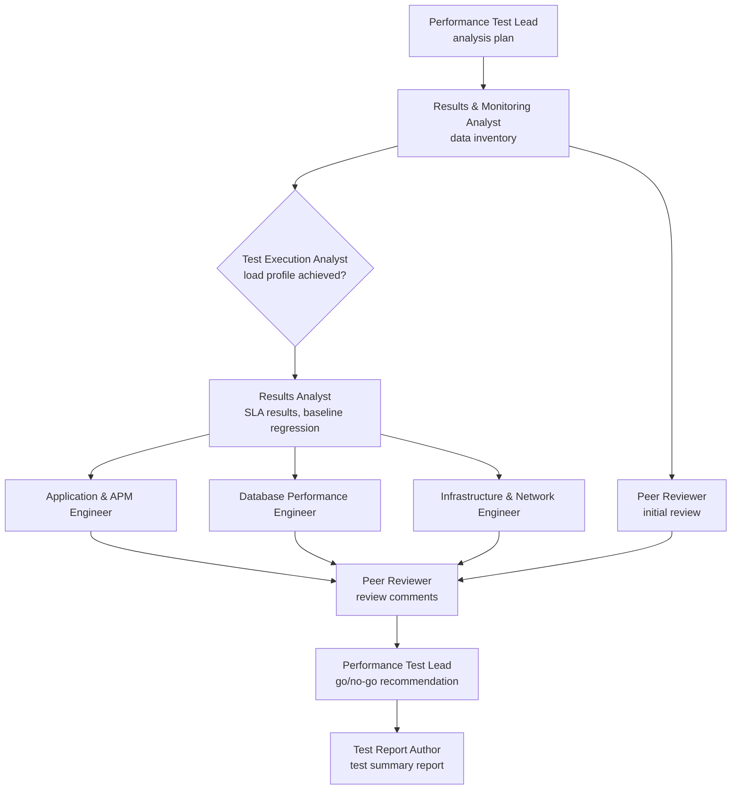

# Agents

Nine agents, modeled on the people a performance team brings into a results analysis. The Performance Test Lead orchestrates the work; the others run as sub-agents, each with its own context, and pass their results forward as handoff files.

Each file below is both the **role description** a person can read and the **instructions the agent runs with**. There is no separate prompt.

`RUN/` in these files is the run folder the runner creates for each run (`<test run folder>/run-<UTC timestamp>/`). Handoff files go there, so files from an earlier or interrupted run are never mixed in.

| Agent | Responsibility | Writes |
| --- | --- | --- |
| [Performance Test Lead](performance-test-lead.md) (orchestrator) | Confirms test type, objective and NFRs; assigns tier reviews; resolves review comments; issues the go/no-go recommendation for a human approver | `01-analysis-plan.md`, `09-go-no-go.md` |
| [Results & Monitoring Analyst](results-monitoring-analyst.md) | Collects results and monitoring, aligns time zones, lists monitoring gaps, records execution metadata, checks the baseline run is available | `02-data-inventory.md` |
| [Test Execution Analyst](test-execution-analyst.md) | Validates the execution: load profile achieved, load generator utilization, runtime settings, script validity and content checks, test data, environment parity | `03-test-execution.md` |
| [Results Analyst](results-analyst.md) | Transaction summary, p90/p95/p99, throughput, errors by type, degradation onset, baseline regression, SLA results | `04-results-analysis.md` |
| [Application & APM Engineer](application-apm-engineer.md) | App tier: threads, connection pools, GC, outbound calls, trace breakdown, app-tier headroom | `05-application-apm.md` |
| [Database Performance Engineer](database-engineer.md) | Query response times, wait events, locks, sessions, batch jobs, database headroom | `06-database.md` |
| [Infrastructure & Network Engineer](infrastructure-network-engineer.md) | Host utilization and headroom, load balancer, network, platform limits | `07-infrastructure-network.md` |
| [Peer Reviewer](peer-reviewer.md) (reviewer agent) | Senior review: forms a view from the data first, then writes review comments on the team's findings | `08a-initial-review.md`, `08b-peer-review.md` |
| [Test Report Author](test-report-author.md) | Test summary report: executive summary, transaction summary, graphs, findings, retest plan, approval block | `RUN/TEST-SUMMARY.md` |

## Workflow

## Design choices

- **Test validity comes first, and one agent owns it.** No agent downstream can turn an invalid test into a valid one. The Performance Test Lead can record a disagreement, not override it.
- **The Peer Reviewer reviews the data before the team's analysis.** Its first run sees only the data and the data inventory. Its second run reviews the team's findings. The Performance Test Lead must resolve every review comment.
- **The three engineers run in parallel,** and each can eliminate its own tier with its own metrics.
- **Math is done by deterministic tooling.** [`tools/analyze.py`](../tools/analyze.py) produces the computed results summary and graphs before any agent runs.
- **Each agent is a real Claude Code sub-agent.** [`.claude/agents/`](../.claude/agents/) defines one sub-agent per role, with its own context and a fixed tool list (read, search, Python, write its own file). No sub-agent has web access or can launch other agents. File-level limits are instructions; see [How the workflow runs](../docs/architecture/how-the-workflow-runs.md).

## Boundaries

- Changing the set of agents is a design decision ([ADR-0002](../docs/decisions/0002-nine-agent-team.md)).
- The Performance Test Lead decides which engineers a given test run needs.
- No agent changes a system, starts a load test, sends anything or publishes data. The agents analyze results and make recommendations.

All agents follow the [analysis workflow](../method/README.md), and everything is written to the [style guide](../docs/style-guide.md).
