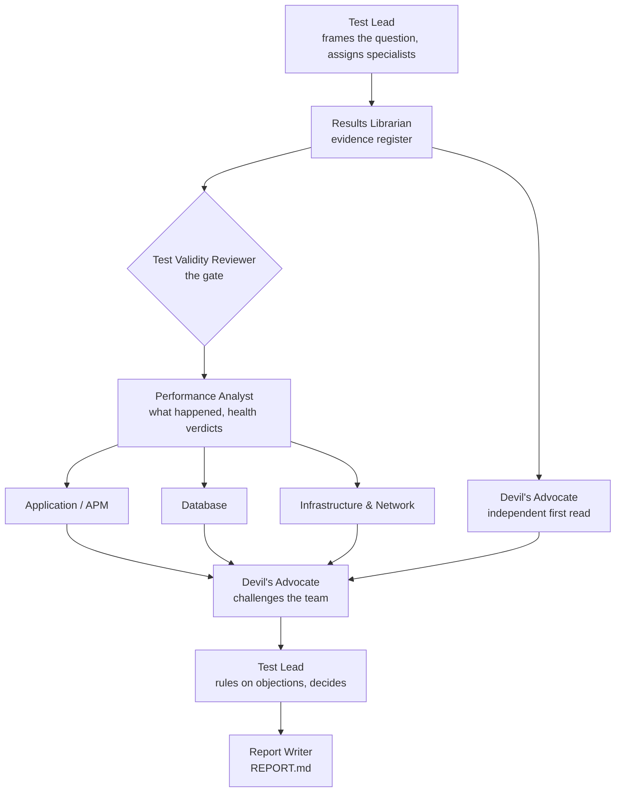

# The review team

Nine agents, each with one seat at the table. They are modelled on the people an experienced performance team pulls into a results review: someone who runs the review, someone who owns the data, someone who decides whether the test is trustworthy, an analyst, the application, database and infrastructure specialists, a sceptic, and someone who writes it up.

Each file below is two things at once: a **role contract** a person can read, and the **instructions the agent actually runs with**. There is no separate hidden prompt.

| Agent | The question they own | Writes |
| --- | --- | --- |
| [Test Lead](test-lead.md) | What are we being asked, who looks at what, and what do we conclude? | `01-test-lead-plan.md`, `09-test-lead-decision.md` |
| [Results Librarian](results-librarian.md) | Is this the right run, is the data complete, and do the clocks agree? | `02-evidence.md` |
| [Test Validity Reviewer](test-validity-reviewer.md) | Did we actually test what we meant to test? | `03-validity.md` |
| [Performance Analyst](performance-analyst.md) | What happened, when did it start, and did it meet the criteria? | `04-performance.md` |
| [Application / APM Specialist](application-specialist.md) | What were the application servers doing while users waited? | `05-application.md` |
| [Database Specialist](database-specialist.md) | Was the database slow, or was everyone waiting to reach it? | `06-database.md` |
| [Infrastructure & Network Specialist](infrastructure-specialist.md) | Could the hosts, network or platform explain this? | `07-infrastructure.md` |
| [Devil's Advocate](devils-advocate.md) | What would a sceptical senior engineer say before this goes out? | `08a-independent-read.md`, `08b-challenge.md` |
| [Report Writer](report-writer.md) | Can a release manager read the first paragraph and know what to do? | `REPORT.md` |

## How they work together

Three design choices matter most:

- **Validity is a gate, owned by one agent.** Nobody downstream can make a broken test valid, and the Test Lead cannot overrule it, only record disagreement.
- **The Devil's Advocate forms a view before seeing the team's.** Its first call sees only the evidence; its second call challenges the team's conclusions. This is how real reviews avoid anchoring on the first explanation.
- **Specialists run in parallel, and each can rule its own layer out.** "The database did not cause this, and here are its metrics" is a finding, not a non-result.

## Shared rules

Every agent follows the [method](../method/README.md): the [four judgments](../method/judgments.md), the [rules](../method/rules.md) and the [record IDs](../method/records.md). Arithmetic is done by [`tools/analyze.py`](../tools/analyze.py), not by the agents.

## Boundaries

- The roles are fixed. Adding or merging a seat is a design decision ([ADR-0002](../docs/decisions/0002-nine-seat-review-team.md)).
- The Test Lead decides which specialists a review needs; an unused seat still exists.
- No agent changes systems, launches load, sends anything or publishes data. The team reads evidence and writes recommendations.
