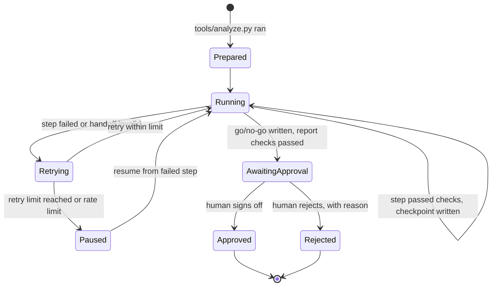

# Concept: a coded orchestrator with checkpoints, resume and human sign-off

> **Status: Concept, not yet implemented.** Today the orchestrator is the [`/review-run`](../../.claude/commands/review-run.md) command: a prompt that Claude Code follows step by step. The example run-state file [`templates/run-state.example.json`](../../templates/run-state.example.json) shows the proposed format; nothing reads or writes it yet.

## Problem

A prompt-driven orchestrator works for a demonstration, but it has no memory outside the conversation. An earlier recorded run showed what that costs. Partway through, the account hit its usage limit and the environment blocked a file write, and the runner had to improvise. In production you need:

- a record of which steps finished and what each one produced;
- the ability to restart from the failed step instead of from the beginning;
- retries with limits;
- a hard stop before anything reaches a release decision;
- a trace of tokens, time and failures per step.

## Design

A small orchestrator program, for example Python using the Claude Agent SDK. It treats the [nine-step workflow](../architecture/how-the-workflow-runs.md) as a state machine.

### Run state

`run/run-state.json` is written after every step. It records, for each step:

- status;
- start and end time;
- model, tokens and retries;
- the output file and its SHA-256 hash;
- the result of the handoff checks.

The hash lets a resumed run prove that earlier outputs were not changed. See [`templates/run-state.example.json`](../../templates/run-state.example.json).

### Step rules

| Rule | Behavior |
| --- | --- |
| Dependencies | A step starts only when every input it lists has status `passed`. |
| Parallel steps | The three engineers, and the Peer Reviewer's initial review, run in parallel. Their dependencies allow it. |
| Validation | After each step, run the [handoff checks](handoff-schema.md#checks-the-orchestrator-would-run-after-each-step). A failed check counts as a failed step. |
| Retries | Up to 2 retries per step. The retry prompt includes the failed check, not the whole previous output. |
| Rate limits | On HTTP 429, pause the run. Save the state, and resume after the reset time. Do not retry in a loop. |
| Resume | `review-run --resume <run folder>` skips steps with status `passed` and matching hashes. |
| Human sign-off | The run ends in `AwaitingApproval`. The test summary report has an approval block. A named person records Approved or Rejected, and the reason, in the run state. No agent can set these states. |
| Write permissions | Each agent can write only its own output path. The orchestrator writes run state and saves output an agent returns as text. |

### Observability

Each step emits one trace span with these fields:

- agent, model and step;
- input files and their sizes;
- tokens in and out, and cache hits;
- duration;
- retries;
- check results.

An OpenTelemetry exporter, or any tracing backend, can collect them. The run log the runner writes by hand today becomes a generated view of these spans.

## What stays the same

The role files, workflow, deterministic tooling and record IDs do not change. The orchestrator replaces only the runner prompt.

## Open questions

- Python with the Claude Agent SDK, or another agent framework. [ADR-0006](../decisions/0006-reference-runtime.md) would need updating.
- Whether the Performance Test Lead stays an LLM agent for planning and the go/no-go recommendation, while step sequencing moves into code. The proposed answer is yes: judgment stays with the agent, control flow moves to code.
