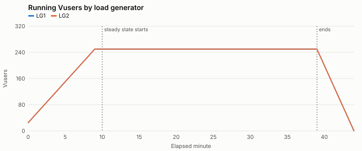
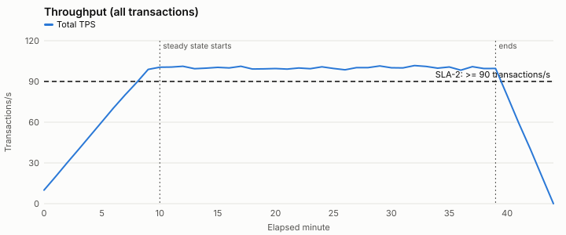
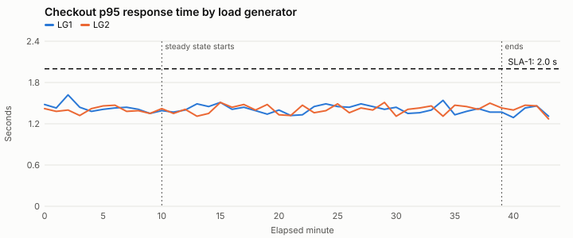
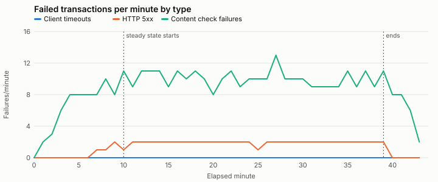

# Computed results summary — SYN-RUN-000

Generated by `tools/analyze.py (deterministic; no AI model involved)`. Every number here is calculated from the raw data files.

**Test objective:** Can the checkout journey support 500 concurrent users at 90+ transactions/second with checkout p95 at or under 2.0 seconds?

**Windows:** min 0-9, min 10-39, min 40-44 — Default windows: planned ramp-up, steady state split at the first minute any SLA fails, and ramp-down.

## Test run overview

| Item | Value |
| --- | --- |
| Test type | load |
| Build under test | syn-shop 4.12.0 |
| Changes since baseline | none listed |
| Baseline run | none |
| Environment parity: app tier | 2 app nodes; production runs 6 of the same size (one-third scale) |
| Environment parity: database | production-size copy, refreshed 2026-09-15; same instance class as production |
| Environment parity: payment provider | shared third-party sandbox; production uses the provider's live service |
| Environment parity: cache | warmed by a 10-minute ramp-up; no separate warm-up run |
| Runtime setting: think time | fixed 3 s before each step |
| Runtime setting: pacing | fixed 20 s |
| Runtime setting: client timeout s | 30 |
| Runtime setting: abort on error | True |
| LG1 | 4 vCPU, log level standard |
| LG2 | 4 vCPU, log level standard |
| Script | checkout_journey v1.8: every step checks for expected page text; correlation validated in a single-Vuser run on 2026-09-30 |
| Test data: customers | SYN-CUST-50K (50,000 accounts, reused across iterations) |
| Test data: products | SYN-SKU-5K (5,000 in-stock SKUs) |

## Transaction summary (steady state)

From `transaction_summary.csv`, the load tool's run-level summary. Response times are for passed transactions, in seconds.

| Load generator | Transaction | Count | Passed | Failed | Error % | Min | Avg | p90 | p95 | p99 | Max | Std dev |
| --- | --- | --- | --- | --- | --- | --- | --- | --- | --- | --- | --- | --- |
| LG1 | search | 45107 | 45018 | 89 | 0.20 | 0.11 | 0.60 | 0.89 | 1.01 | 1.28 | 2.21 | 0.22 |
| LG1 | add_to_cart | 22436 | 22393 | 43 | 0.19 | 0.10 | 0.40 | 0.59 | 0.67 | 0.86 | 1.68 | 0.15 |
| LG1 | checkout | 22619 | 22572 | 47 | 0.21 | 0.20 | 0.85 | 1.25 | 1.42 | 1.82 | 3.60 | 0.31 |
| LG2 | search | 45019 | 44925 | 94 | 0.21 | 0.14 | 0.60 | 0.89 | 1.01 | 1.28 | 2.50 | 0.22 |
| LG2 | add_to_cart | 22421 | 22381 | 40 | 0.18 | 0.10 | 0.40 | 0.59 | 0.67 | 0.85 | 1.76 | 0.14 |
| LG2 | checkout | 22513 | 22466 | 47 | 0.21 | 0.20 | 0.84 | 1.25 | 1.41 | 1.79 | 3.61 | 0.31 |
| ALL | search | 90126 | 89943 | 183 | 0.20 | 0.11 | 0.60 | 0.89 | 1.01 | 1.28 | 2.50 | 0.22 |
| ALL | add_to_cart | 44857 | 44774 | 83 | 0.19 | 0.10 | 0.40 | 0.59 | 0.67 | 0.86 | 1.76 | 0.14 |
| ALL | checkout | 45132 | 45038 | 94 | 0.21 | 0.20 | 0.85 | 1.25 | 1.42 | 1.81 | 3.61 | 0.31 |

## Graphs

## Errors by type

| Window | Load generator | Transactions | Failed | Client timeouts | HTTP 5xx | Content check failures |
| --- | --- | --- | --- | --- | --- | --- |
| min 0-9 | LG1 | 16547 | 34 | 0 | 3 | 31 |
| min 0-9 | LG2 | 16413 | 31 | 0 | 1 | 30 |
| min 10-39 | LG1 | 90162 | 179 | 0 | 28 | 151 |
| min 10-39 | LG2 | 89953 | 181 | 0 | 30 | 151 |
| min 40-44 | LG1 | 5991 | 12 | 0 | 0 | 12 |
| min 40-44 | LG2 | 5991 | 12 | 0 | 0 | 12 |

## Capacity: CPU-bound throughput ceiling (conditional estimate)

Utilization Law (U = X × D): CPU % per transaction/s, and the throughput each tier would reach at 80% CPU **if CPU were the only limit**. This is not the tier's capacity. When another resource is saturated, it limits throughput first. "No other monitored limit detected" does not prove CPU is the limit: unmonitored resources such as external APIs, the network or locks can still cap throughput. Only valid if CPU is the limiting resource. Also assumes even load balancing across app nodes and CPU that scales linearly with throughput. Applies to this test environment only; do not scale to production without stating the ratio.

| Window | Tier | Mean CPU % | TPS handled | CPU % per TPS | CPU-bound ceiling (TPS) | Other limits seen |
| --- | --- | --- | --- | --- | --- | --- |
| min 0-9 | app1 | 33.0 | 27.5 | 1.201 | 66.6 | no other monitored limit detected |
| min 0-9 | app2 | 32.4 | 27.5 | 1.18 | 67.8 | no other monitored limit detected |
| min 0-9 | database | 17.9 | 54.9 | 0.326 | 245.6 | not checked |
| min 10-39 | app1 | 52.9 | 50.0 | 1.058 | 75.6 | no other monitored limit detected |
| min 10-39 | app2 | 53.3 | 50.0 | 1.065 | 75.1 | no other monitored limit detected |
| min 10-39 | database | 30.5 | 100.1 | 0.305 | 262.3 | not checked |
| min 40-44 | app1 | 25.5 | 25.0 | 1.022 | 78.3 | no other monitored limit detected |
| min 40-44 | app2 | 25.4 | 25.0 | 1.018 | 78.6 | no other monitored limit detected |
| min 40-44 | database | 14.7 | 49.9 | 0.294 | 272.1 | not checked |

## Input checks

All listed files loaded. No malformed values, timestamp mismatches or duplicate rows found.

## Data inventory

| File | Rows/lines | UTC range | Coverage | Missing minutes | Notes |
| --- | --- | --- | --- | --- | --- |
| transactions.csv | 264 | 2026-09-24T10:00:00Z → 2026-09-24T10:43:00Z | LG1 44/45 minutes; LG2 44/45 minutes | none | Percentiles are per generator per minute; they cannot be averaged into run-level percentiles. |
| transaction_summary.csv | 9 |  | steady state run-level summary | none |  |
| vusers.csv | 90 | 2026-09-24T10:00:00Z → 2026-09-24T10:44:00Z | LG1 45/45 minutes; LG2 45/45 minutes | none |  |
| load_generators.csv | 90 | 2026-09-24T10:00:00Z → 2026-09-24T10:44:00Z | LG1 45/45 minutes; LG2 45/45 minutes | none |  |
| app_servers.csv | 90 | 2026-09-24T10:00:00Z → 2026-09-24T10:44:00Z | app1 45/45 minutes; app2 45/45 minutes | none |  |
| database.csv | 45 | 2026-09-24T10:00:00Z → 2026-09-24T10:44:00Z | all 45/45 minutes | none | converted to UTC using the offset in each timestamp; Exported from the database host, not the APM tool. |
| network.csv | 45 | 2026-09-24T10:00:00Z → 2026-09-24T10:44:00Z | lb1 45/45 minutes | none |  |
| external_calls.csv | 45 | 2026-09-24T10:00:00Z → 2026-09-24T10:44:00Z | payment-sandbox 45/45 minutes | none |  |
| checkout_traces.csv | 132 | 2026-09-24T10:00:10Z → 2026-09-24T10:43:44Z |  | none | Sample, not every request. |

## Load profile by minute

| Min | Scheduled Vusers | Running Vusers | Exited on error | TPS | Error % | Implied cycle (s) |
| --- | --- | --- | --- | --- | --- | --- |
| 0 | 50 | 50 | 0 | 10.0 | 0.0 | 19.9 |
| 1 | 100 | 100 | 0 | 19.9 | 0.17 | 20.2 |
| 2 | 150 | 150 | 0 | 30.2 | 0.17 | 20.0 |
| 3 | 200 | 200 | 0 | 40.1 | 0.25 | 19.8 |
| 4 | 250 | 250 | 0 | 50.2 | 0.27 | 19.8 |
| 5 | 300 | 300 | 0 | 60.3 | 0.22 | 20.0 |
| 6 | 350 | 350 | 0 | 70.5 | 0.19 | 20.2 |
| 7 | 400 | 400 | 0 | 80.1 | 0.19 | 19.7 |
| 8 | 450 | 450 | 0 | 89.2 | 0.21 | 20.3 |
| 9 | 500 | 500 | 0 | 98.9 | 0.17 | 20.0 |
| 10 | 500 | 500 | 0 | 100.5 | 0.2 | 19.5 |
| 11 | 500 | 500 | 0 | 100.6 | 0.18 | 19.8 |
| 12 | 500 | 500 | 0 | 101.2 | 0.21 | 19.9 |
| 13 | 500 | 500 | 0 | 99.4 | 0.22 | 19.7 |
| 14 | 500 | 500 | 0 | 99.8 | 0.22 | 19.8 |
| 15 | 500 | 500 | 0 | 100.4 | 0.18 | 20.0 |
| 16 | 500 | 500 | 0 | 100.0 | 0.22 | 19.6 |
| 17 | 500 | 500 | 0 | 101.2 | 0.2 | 19.6 |
| 18 | 500 | 500 | 0 | 99.2 | 0.22 | 19.8 |
| 19 | 500 | 500 | 0 | 99.3 | 0.2 | 20.2 |
| 20 | 500 | 500 | 0 | 99.5 | 0.17 | 20.5 |
| 21 | 500 | 500 | 0 | 99.1 | 0.2 | 19.9 |
| 22 | 500 | 500 | 0 | 99.9 | 0.22 | 19.8 |
| 23 | 500 | 500 | 0 | 99.4 | 0.18 | 20.2 |
| 24 | 500 | 500 | 0 | 100.8 | 0.2 | 19.7 |
| 25 | 500 | 500 | 0 | 99.6 | 0.18 | 20.1 |
| 26 | 500 | 500 | 0 | 98.6 | 0.2 | 20.4 |
| 27 | 500 | 500 | 0 | 100.2 | 0.25 | 20.0 |
| 28 | 500 | 500 | 0 | 100.2 | 0.2 | 19.8 |
| 29 | 500 | 500 | 0 | 101.4 | 0.2 | 19.7 |
| 30 | 500 | 500 | 0 | 100.1 | 0.2 | 19.8 |
| 31 | 500 | 500 | 0 | 100.0 | 0.18 | 20.2 |
| 32 | 500 | 500 | 0 | 101.7 | 0.18 | 19.5 |
| 33 | 500 | 500 | 0 | 101.1 | 0.18 | 20.2 |
| 34 | 500 | 500 | 0 | 99.8 | 0.18 | 19.6 |
| 35 | 500 | 500 | 0 | 100.7 | 0.22 | 20.0 |
| 36 | 500 | 500 | 0 | 98.3 | 0.19 | 20.2 |
| 37 | 500 | 500 | 0 | 100.9 | 0.21 | 20.1 |
| 38 | 500 | 500 | 0 | 99.5 | 0.18 | 20.5 |
| 39 | 500 | 500 | 0 | 99.6 | 0.22 | 20.1 |
| 40 | 400 | 400 | 0 | 79.7 | 0.17 | 20.0 |
| 41 | 300 | 300 | 0 | 59.5 | 0.22 | 20.3 |
| 42 | 200 | 200 | 0 | 40.4 | 0.25 | 19.8 |
| 43 | 100 | 100 | 0 | 20.1 | 0.17 | 20.1 |
| 44 | 0 | 0 | 0 | 0.0 | None | None |

Pacing: 20.0s. implied_cycle_s = running users / iterations per second (one checkout per iteration). With fixed pacing it should equal the pacing interval; a larger value means iterations are running late (responses + think time exceed pacing).

### Throughput by generator (TPS)

- LG1: 0:5.0, 1:10.0, 2:15.0, 3:20.1, 4:25.2, 5:30.4, 6:35.3, 7:40.6, 8:44.9, 9:49.4, 10:50.5, 11:49.7, 12:51.0, 13:49.6, 14:50.1, 15:50.5, 16:50.4, 17:50.9, 18:49.6, 19:49.7, 20:50.1, 21:50.1, 22:50.1, 23:50.3, 24:50.0, 25:49.3, 26:49.6, 27:50.5, 28:50.5, 29:51.0, 30:49.6, 31:50.4, 32:50.9, 33:50.1, 34:49.4, 35:50.2, 36:49.2, 37:50.5, 38:49.2, 39:49.6, 40:40.3, 41:29.3, 42:20.3, 43:9.9
- LG2: 0:5.0, 1:10.0, 2:15.2, 3:20.0, 4:25.0, 5:29.9, 6:35.1, 7:39.5, 8:44.2, 9:49.5, 10:50.0, 11:50.9, 12:50.2, 13:49.9, 14:49.7, 15:49.9, 16:49.6, 17:50.3, 18:49.6, 19:49.6, 20:49.5, 21:48.9, 22:49.8, 23:49.1, 24:50.8, 25:50.3, 26:48.9, 27:49.7, 28:49.7, 29:50.4, 30:50.5, 31:49.6, 32:50.8, 33:51.0, 34:50.4, 35:50.4, 36:49.1, 37:50.4, 38:50.2, 39:50.0, 40:39.4, 41:30.2, 42:20.1, 43:10.2

## SLA results (steady state)

Calculated from the data only; the Test Execution Analyst decides whether the run is valid enough to report these as SLA results. Thresholds come from scenario.json. A missing measurement is Not evaluated, never Pass. Response time SLAs are judged per load generator per minute because percentiles cannot be averaged. First minute any SLA failed: None.

| SLA | Metric | Threshold | Evaluation | Result | Minutes Pass / Fail / Not evaluated | Window value | Notes |
| --- | --- | --- | --- | --- | --- | --- | --- |
| SLA-1 | checkout p95 response time | <= 2.0 s | per_minute_per_generator | **Pass** | 30 / 0 / 0 |  |  |
| SLA-2 | total throughput | >= 90 transactions/s | per_minute | **Pass** | 30 / 0 / 0 |  |  |
| SLA-3 | transaction error rate | <= 1% | window | **Pass** |  | 0.2 |  |

Per minute:

| Min | SLA-1 | SLA-2 | SLA-3 |
| --- | --- | --- | --- |
| 10 | LG1 1.39, LG2 1.42: Pass | 100.48: Pass | 0.2 (judged on window) |
| 11 | LG1 1.37, LG2 1.35: Pass | 100.62: Pass | 0.18 (judged on window) |
| 12 | LG1 1.4, LG2 1.41: Pass | 101.2: Pass | 0.21 (judged on window) |
| 13 | LG1 1.49, LG2 1.31: Pass | 99.42: Pass | 0.22 (judged on window) |
| 14 | LG1 1.45, LG2 1.35: Pass | 99.82: Pass | 0.22 (judged on window) |
| 15 | LG1 1.51, LG2 1.51: Pass | 100.42: Pass | 0.18 (judged on window) |
| 16 | LG1 1.41, LG2 1.44: Pass | 99.95: Pass | 0.22 (judged on window) |
| 17 | LG1 1.44, LG2 1.48: Pass | 101.22: Pass | 0.2 (judged on window) |
| 18 | LG1 1.39, LG2 1.4: Pass | 99.22: Pass | 0.22 (judged on window) |
| 19 | LG1 1.34, LG2 1.48: Pass | 99.32: Pass | 0.2 (judged on window) |
| 20 | LG1 1.4, LG2 1.33: Pass | 99.52: Pass | 0.17 (judged on window) |
| 21 | LG1 1.32, LG2 1.32: Pass | 99.08: Pass | 0.2 (judged on window) |
| 22 | LG1 1.33, LG2 1.47: Pass | 99.93: Pass | 0.22 (judged on window) |
| 23 | LG1 1.45, LG2 1.36: Pass | 99.37: Pass | 0.18 (judged on window) |
| 24 | LG1 1.49, LG2 1.39: Pass | 100.77: Pass | 0.2 (judged on window) |
| 25 | LG1 1.45, LG2 1.49: Pass | 99.6: Pass | 0.18 (judged on window) |
| 26 | LG1 1.44, LG2 1.36: Pass | 98.57: Pass | 0.2 (judged on window) |
| 27 | LG1 1.49, LG2 1.43: Pass | 100.17: Pass | 0.25 (judged on window) |
| 28 | LG1 1.45, LG2 1.4: Pass | 100.15: Pass | 0.2 (judged on window) |
| 29 | LG1 1.41, LG2 1.51: Pass | 101.42: Pass | 0.2 (judged on window) |
| 30 | LG1 1.44, LG2 1.31: Pass | 100.1: Pass | 0.2 (judged on window) |
| 31 | LG1 1.35, LG2 1.41: Pass | 100.03: Pass | 0.18 (judged on window) |
| 32 | LG1 1.36, LG2 1.43: Pass | 101.67: Pass | 0.18 (judged on window) |
| 33 | LG1 1.4, LG2 1.46: Pass | 101.1: Pass | 0.18 (judged on window) |
| 34 | LG1 1.54, LG2 1.31: Pass | 99.78: Pass | 0.18 (judged on window) |
| 35 | LG1 1.33, LG2 1.47: Pass | 100.67: Pass | 0.22 (judged on window) |
| 36 | LG1 1.38, LG2 1.45: Pass | 98.35: Pass | 0.19 (judged on window) |
| 37 | LG1 1.42, LG2 1.41: Pass | 100.9: Pass | 0.21 (judged on window) |
| 38 | LG1 1.37, LG2 1.5: Pass | 99.48: Pass | 0.18 (judged on window) |
| 39 | LG1 1.37, LG2 1.43: Pass | 99.62: Pass | 0.22 (judged on window) |

## Metrics by time window

Percentile columns show the median and max of per-minute values — not a recomputed percentile.

### transactions.csv

**min 0-9**

- LG1 / add_to_cart: minutes_present 10; count 77.0/412.3/751.0; passed 77.0/411.4/750.0; failed 0.0/0.9/2.0; failed_timeout 0.0/0.0/0.0; failed_http_5xx 0.0/0.0/0.0; failed_content_check 0.0/0.9/2.0; min_s 0.11/0.14/0.16; avg_s 0.38/0.4/0.44; p90_s 0.59/0.76; p95_s 0.66/0.86; p99_s 0.83/1.1; max_s 0.8/1.04/1.32
- LG1 / checkout: minutes_present 10; count 74.0/411.4/731.0; passed 74.0/410.7/730.0; failed 0.0/0.7/1.0; failed_timeout 0.0/0.0/0.0; failed_http_5xx 0.0/0.0/0.0; failed_content_check 0.0/0.7/1.0; min_s 0.28/0.33/0.46; avg_s 0.83/0.86/0.9; p90_s 1.26/1.34; p95_s 1.43/1.62; p99_s 1.78/2.05; max_s 1.88/2.36/2.9
- LG1 / search: minutes_present 10; count 152.0/831.0/1481.0; passed 152.0/829.2/1478.0; failed 0.0/1.8/3.0; failed_timeout 0.0/0.0/0.0; failed_http_5xx 0.0/0.3/1.0; failed_content_check 0.0/1.5/2.0; min_s 0.13/0.19/0.26; avg_s 0.57/0.6/0.63; p90_s 0.89/0.93; p95_s 1.01/1.05; p99_s 1.28/1.35; max_s 1.22/1.6/1.98
- LG2 / add_to_cart: minutes_present 10; count 75.0/410.6/731.0; passed 75.0/409.8/730.0; failed 0.0/0.8/2.0; failed_timeout 0.0/0.0/0.0; failed_http_5xx 0.0/0.0/0.0; failed_content_check 0.0/0.8/2.0; min_s 0.11/0.14/0.16; avg_s 0.38/0.4/0.42; p90_s 0.59/0.65; p95_s 0.68/0.76; p99_s 0.88/0.93; max_s 0.87/1.05/1.2
- LG2 / checkout: minutes_present 10; count 77.0/413.0/766.0; passed 77.0/412.3/765.0; failed 0.0/0.7/1.0; failed_timeout 0.0/0.0/0.0; failed_http_5xx 0.0/0.0/0.0; failed_content_check 0.0/0.7/1.0; min_s 0.22/0.28/0.34; avg_s 0.82/0.84/0.88; p90_s 1.21/1.29; p95_s 1.4/1.47; p99_s 1.75/1.99; max_s 1.66/2.3/3.18
- LG2 / search: minutes_present 10; count 146.0/817.7/1476.0; passed 146.0/816.1/1473.0; failed 0.0/1.6/3.0; failed_timeout 0.0/0.0/0.0; failed_http_5xx 0.0/0.1/1.0; failed_content_check 0.0/1.5/2.0; min_s 0.13/0.19/0.26; avg_s 0.58/0.61/0.63; p90_s 0.9/0.93; p95_s 1.02/1.04; p99_s 1.27/1.51; max_s 1.37/1.73/1.99

**min 10-39**

- LG1 / add_to_cart: minutes_present 30; count 728.0/747.87/772.0; passed 727.0/746.43/771.0; failed 1.0/1.43/2.0; failed_timeout 0.0/0.0/0.0; failed_http_5xx 0.0/0.0/0.0; failed_content_check 1.0/1.43/2.0; min_s 0.1/0.13/0.15; avg_s 0.38/0.4/0.43; p90_s 0.59/0.63; p95_s 0.67/0.72; p99_s 0.86/0.98; max_s 0.94/1.13/1.68
- LG1 / checkout: minutes_present 30; count 729.0/753.97/772.0; passed 728.0/752.4/770.0; failed 1.0/1.57/2.0; failed_timeout 0.0/0.0/0.0; failed_http_5xx 0.0/0.0/0.0; failed_content_check 1.0/1.57/2.0; min_s 0.2/0.26/0.33; avg_s 0.81/0.85/0.89; p90_s 1.25/1.35; p95_s 1.4/1.54; p99_s 1.81/2.19; max_s 1.88/2.45/3.6
- LG1 / search: minutes_present 30; count 1462.0/1503.57/1545.0; passed 1459.0/1500.6/1542.0; failed 2.0/2.97/4.0; failed_timeout 0.0/0.0/0.0; failed_http_5xx 0.0/0.93/1.0; failed_content_check 2.0/2.03/3.0; min_s 0.11/0.17/0.22; avg_s 0.56/0.6/0.63; p90_s 0.89/0.92; p95_s 1.01/1.07; p99_s 1.27/1.4; max_s 1.55/1.78/2.21
- LG2 / add_to_cart: minutes_present 30; count 728.0/747.37/769.0; passed 727.0/746.03/767.0; failed 1.0/1.33/2.0; failed_timeout 0.0/0.0/0.0; failed_http_5xx 0.0/0.0/0.0; failed_content_check 1.0/1.33/2.0; min_s 0.1/0.12/0.16; avg_s 0.37/0.4/0.42; p90_s 0.6/0.63; p95_s 0.67/0.72; p99_s 0.84/0.93; max_s 0.81/1.11/1.76
- LG2 / checkout: minutes_present 30; count 729.0/750.43/772.0; passed 728.0/748.87/771.0; failed 1.0/1.57/2.0; failed_timeout 0.0/0.0/0.0; failed_http_5xx 0.0/0.0/0.0; failed_content_check 1.0/1.57/2.0; min_s 0.2/0.26/0.33; avg_s 0.78/0.84/0.89; p90_s 1.25/1.32; p95_s 1.42/1.51; p99_s 1.78/1.96; max_s 1.92/2.34/3.61
- LG2 / search: minutes_present 30; count 1456.0/1500.63/1544.0; passed 1453.0/1497.5/1541.0; failed 3.0/3.13/4.0; failed_timeout 0.0/0.0/0.0; failed_http_5xx 1.0/1.0/1.0; failed_content_check 2.0/2.13/3.0; min_s 0.14/0.18/0.21; avg_s 0.57/0.6/0.63; p90_s 0.89/0.93; p95_s 1.0/1.07; p99_s 1.27/1.4; max_s 1.54/1.9/2.5

**min 40-44**

- LG1 / add_to_cart: minutes_present 4; count 146.0/369.75/593.0; passed 146.0/369.0/592.0; failed 0.0/0.75/1.0; failed_timeout 0.0/0.0/0.0; failed_http_5xx 0.0/0.0/0.0; failed_content_check 0.0/0.75/1.0; min_s 0.08/0.12/0.15; avg_s 0.37/0.39/0.41; p90_s 0.57/0.59; p95_s 0.62/0.64; p99_s 0.74/0.76; max_s 0.75/0.94/1.17
- LG1 / checkout: minutes_present 4; count 150.0/376.25/605.0; passed 150.0/375.5/604.0; failed 0.0/0.75/1.0; failed_timeout 0.0/0.0/0.0; failed_http_5xx 0.0/0.0/0.0; failed_content_check 0.0/0.75/1.0; min_s 0.25/0.27/0.29; avg_s 0.79/0.83/0.89; p90_s 1.23/1.3; p95_s 1.37/1.46; p99_s 1.85/1.99; max_s 2.08/2.43/2.85
- LG1 / search: minutes_present 4; count 298.0/751.75/1221.0; passed 297.0/750.25/1219.0; failed 1.0/1.5/2.0; failed_timeout 0.0/0.0/0.0; failed_http_5xx 0.0/0.0/0.0; failed_content_check 1.0/1.5/2.0; min_s 0.15/0.18/0.21; avg_s 0.57/0.59/0.6; p90_s 0.89/0.89; p95_s 0.99/1.0; p99_s 1.29/1.31; max_s 1.45/1.54/1.64
- LG2 / add_to_cart: minutes_present 4; count 153.0/375.75/589.0; passed 153.0/375.0/588.0; failed 0.0/0.75/1.0; failed_timeout 0.0/0.0/0.0; failed_http_5xx 0.0/0.0/0.0; failed_content_check 0.0/0.75/1.0; min_s 0.12/0.14/0.16; avg_s 0.38/0.4/0.41; p90_s 0.58/0.6; p95_s 0.68/0.7; p99_s 0.86/0.9; max_s 0.95/1.07/1.42
- LG2 / checkout: minutes_present 4; count 149.0/371.5/595.0; passed 149.0/370.75/594.0; failed 0.0/0.75/1.0; failed_timeout 0.0/0.0/0.0; failed_http_5xx 0.0/0.0/0.0; failed_content_check 0.0/0.75/1.0; min_s 0.27/0.29/0.32; avg_s 0.79/0.84/0.88; p90_s 1.23/1.25; p95_s 1.43/1.47; p99_s 1.77/1.97; max_s 1.8/2.06/2.44
- LG2 / search: minutes_present 4; count 309.0/750.5/1181.0; passed 308.0/749.0/1179.0; failed 1.0/1.5/2.0; failed_timeout 0.0/0.0/0.0; failed_http_5xx 0.0/0.0/0.0; failed_content_check 1.0/1.5/2.0; min_s 0.14/0.17/0.22; avg_s 0.58/0.6/0.64; p90_s 0.89/0.97; p95_s 1.01/1.05; p99_s 1.31/1.42; max_s 1.65/1.77/1.85

(values are min/mean/max, or median/max for percentiles)

### vusers.csv

**min 0-9**

- LG1: minutes_present 10; scheduled_vusers 25.0/137.5/250.0; running_vusers 25.0/137.5/250.0; exited_with_error 0.0/0.0/0.0
- LG2: minutes_present 10; scheduled_vusers 25.0/137.5/250.0; running_vusers 25.0/137.5/250.0; exited_with_error 0.0/0.0/0.0

**min 10-39**

- LG1: minutes_present 30; scheduled_vusers 250.0/250.0/250.0; running_vusers 250.0/250.0/250.0; exited_with_error 0.0/0.0/0.0
- LG2: minutes_present 30; scheduled_vusers 250.0/250.0/250.0; running_vusers 250.0/250.0/250.0; exited_with_error 0.0/0.0/0.0

**min 40-44**

- LG1: minutes_present 5; scheduled_vusers 0.0/100.0/200.0; running_vusers 0.0/100.0/200.0; exited_with_error 0.0/0.0/0.0
- LG2: minutes_present 5; scheduled_vusers 0.0/100.0/200.0; running_vusers 0.0/100.0/200.0; exited_with_error 0.0/0.0/0.0

(values are min/mean/max, or median/max for percentiles)

### load_generators.csv

**min 0-9**

- LG1: minutes_present 10; cpu_pct 18.1/30.39/45.5; memory_pct 40.2/47.25/55.3; script_errors 0.0/0.0/0.0
- LG2: minutes_present 10; cpu_pct 17.2/30.39/45.5; memory_pct 40.2/47.23/55.0; script_errors 0.0/0.0/0.0

**min 10-39**

- LG1: minutes_present 30; cpu_pct 42.1/43.92/45.8; memory_pct 53.1/55.15/57.3; script_errors 0.0/0.0/0.0
- LG2: minutes_present 30; cpu_pct 42.0/44.0/45.9; memory_pct 53.6/55.08/56.8; script_errors 0.0/0.0/0.0

**min 40-44**

- LG1: minutes_present 5; cpu_pct 14.4/25.76/36.6; memory_pct 39.3/46.54/52.8; script_errors 0.0/0.0/0.0
- LG2: minutes_present 5; cpu_pct 13.6/25.8/37.1; memory_pct 39.7/46.5/52.2; script_errors 0.0/0.0/0.0

(values are min/mean/max, or median/max for percentiles)

### app_servers.csv

**min 0-9**

- app1: minutes_present 10; cpu_pct 12.8/32.98/53.5; heap_used_pct 54.2/56.84/61.9; gc_pause_ms 70.0/98.5/130.0; active_threads 6.0/15.2/24.0; max_threads 200.0/200.0/200.0; db_pool_active 2.0/4.9/7.0; db_pool_max 20.0/20.0/20.0; db_pool_wait_ms 0.0/0.8/2.0
- app2: minutes_present 10; cpu_pct 11.0/32.41/53.0; heap_used_pct 54.4/57.74/61.4; gc_pause_ms 68.0/101.8/128.0; active_threads 8.0/15.9/25.0; max_threads 200.0/200.0/200.0; db_pool_active 3.0/5.2/8.0; db_pool_max 20.0/20.0/20.0; db_pool_wait_ms 0.0/1.0/2.0

**min 10-39**

- app1: minutes_present 30; cpu_pct 50.9/52.93/54.9; heap_used_pct 54.2/57.84/62.0; gc_pause_ms 68.0/102.63/133.0; active_threads 21.0/23.87/26.0; max_threads 200.0/200.0/200.0; db_pool_active 6.0/7.07/8.0; db_pool_max 20.0/20.0/20.0; db_pool_wait_ms 0.0/0.8/2.0
- app2: minutes_present 30; cpu_pct 50.6/53.27/55.3; heap_used_pct 54.8/58.74/61.8; gc_pause_ms 68.0/99.13/130.0; active_threads 21.0/23.7/26.0; max_threads 200.0/200.0/200.0; db_pool_active 6.0/6.8/8.0; db_pool_max 20.0/20.0/20.0; db_pool_wait_ms 0.0/1.2/2.0

**min 40-44**

- app1: minutes_present 5; cpu_pct 8.1/25.5/44.1; heap_used_pct 55.4/58.54/60.6; gc_pause_ms 77.0/110.6/134.0; active_threads 4.0/11.4/18.0; max_threads 200.0/200.0/200.0; db_pool_active 2.0/3.6/5.0; db_pool_max 20.0/20.0/20.0; db_pool_wait_ms 0.0/1.0/2.0
- app2: minutes_present 5; cpu_pct 6.4/25.42/42.8; heap_used_pct 55.3/56.36/57.7; gc_pause_ms 114.0/120.6/132.0; active_threads 7.0/12.6/20.0; max_threads 200.0/200.0/200.0; db_pool_active 2.0/4.4/6.0; db_pool_max 20.0/20.0/20.0; db_pool_wait_ms 0.0/1.0/2.0

(values are min/mean/max, or median/max for percentiles)

### database.csv

**min 0-9**

- all: minutes_present 10; cpu_pct 9.3/17.89/27.5; active_sessions 4.0/6.8/9.0; avg_query_ms 10.5/11.28/12.4; lock_wait_ms 2.0/5.2/7.0

**min 10-39**

- all: minutes_present 30; cpu_pct 26.3/30.51/47.6; active_sessions 9.0/10.3/16.0; avg_query_ms 10.0/12.4/21.0; lock_wait_ms 2.0/118.47/935.0

**min 40-44**

- all: minutes_present 5; cpu_pct 6.2/14.68/22.7; active_sessions 4.0/6.0/8.0; avg_query_ms 10.8/11.28/12.2; lock_wait_ms 4.0/5.6/7.0

(values are min/mean/max, or median/max for percentiles)

### network.csv

**min 0-9**

- lb1: minutes_present 10; active_connections 27.0/169.4/308.0; throughput_mbps 3.9/23.14/42.0; retransmit_pct 0.01/0.03/0.04

**min 10-39**

- lb1: minutes_present 30; active_connections 305.0/309.03/314.0; throughput_mbps 41.1/42.22/43.3; retransmit_pct 0.01/0.02/0.04

**min 40-44**

- lb1: minutes_present 5; active_connections 3.0/122.6/248.0; throughput_mbps 0.7/16.8/33.0; retransmit_pct 0.01/0.02/0.03

(values are min/mean/max, or median/max for percentiles)

### external_calls.csv

**min 0-9**

- payment-sandbox: minutes_present 10; calls 151.0/824.4/1497.0; avg_ms 230.0/250.2/268.0; p95_ms 368.5/414.0; errors 0.0/0.0/0.0

**min 10-39**

- payment-sandbox: minutes_present 30; calls 1465.0/1504.4/1537.0; avg_ms 231.0/246.67/267.0; p95_ms 370.0/414.0; errors 0.0/0.0/0.0

**min 40-44**

- payment-sandbox: minutes_present 5; calls 0.0/598.2/1200.0; avg_ms 244.0/256.2/269.0; p95_ms 383.0/419.0; errors 0.0/0.0/0.0

(values are min/mean/max, or median/max for percentiles)

### checkout_traces.csv

**min 0-9**

- app1 / checkout: minutes_present 10; total_ms 360.0/473.3/560.0; pool_wait_ms 0.0/0.0/0.0; sql_ms 25.0/39.35/57.0; payment_call_ms 205.0/264.95/310.0; db_connection_held_ms 264.0/321.35/362.0
- app2 / checkout: minutes_present 10; total_ms 385.0/467.7/546.0; pool_wait_ms 0.0/0.0/0.0; sql_ms 30.0/43.5/56.0; payment_call_ms 205.0/255.9/315.0; db_connection_held_ms 258.0/316.3/363.0

**min 10-39**

- app1 / checkout: minutes_present 30; total_ms 351.0/454.33/568.0; pool_wait_ms 0.0/0.0/0.0; sql_ms 25.0/41.95/59.0; payment_call_ms 199.0/253.47/317.0; db_connection_held_ms 263.0/312.27/381.0
- app2 / checkout: minutes_present 30; total_ms 335.0/444.63/569.0; pool_wait_ms 0.0/0.0/0.0; sql_ms 25.0/41.27/57.0; payment_call_ms 203.0/254.6/312.0; db_connection_held_ms 250.0/312.37/380.0

**min 40-44**

- app1 / checkout: minutes_present 4; total_ms 398.0/469.88/536.0; pool_wait_ms 0.0/0.0/0.0; sql_ms 27.0/43.12/50.0; payment_call_ms 234.0/272.62/291.0; db_connection_held_ms 289.0/329.5/353.0
- app2 / checkout: minutes_present 4; total_ms 407.0/441.75/503.0; pool_wait_ms 0.0/0.0/0.0; sql_ms 28.0/35.5/46.0; payment_call_ms 230.0/253.25/271.0; db_connection_held_ms 273.0/305.75/336.0

(values are min/mean/max, or median/max for percentiles)

## Checkout trace breakdown (medians)

| Window | Traces | Total | Pool wait | SQL | Payment call | Connection held | Payment share of hold % |
| --- | --- | --- | --- | --- | --- | --- | --- |
| min 0-9 | 30 | 474.0 | 0.0 | 41.0 | 262.0 | 317.0 | 81.9 |
| min 10-39 | 90 | 454.0 | 0.0 | 40.0 | 252.0 | 312.0 | 81.3 |
| min 40-44 | 12 | 454.0 | 0.0 | 44.0 | 270.0 | 330.0 | 82.8 |
