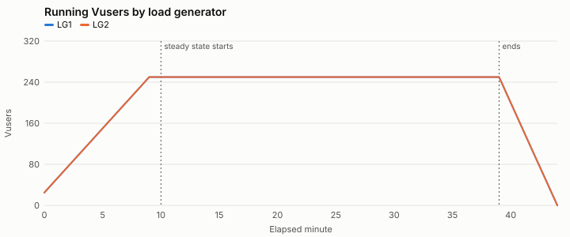
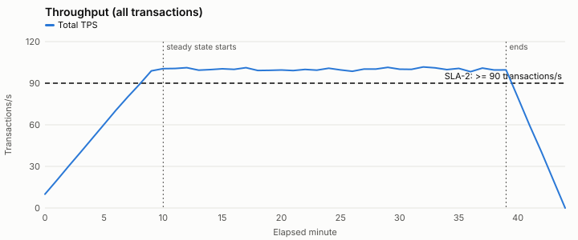
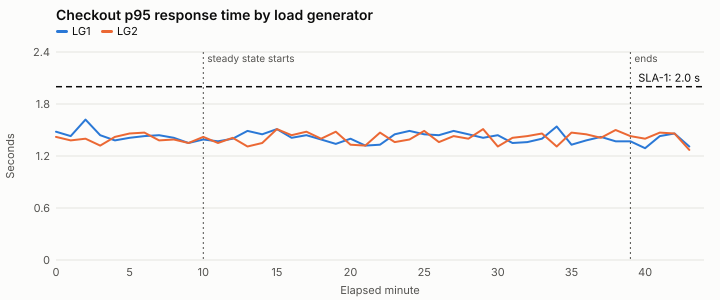
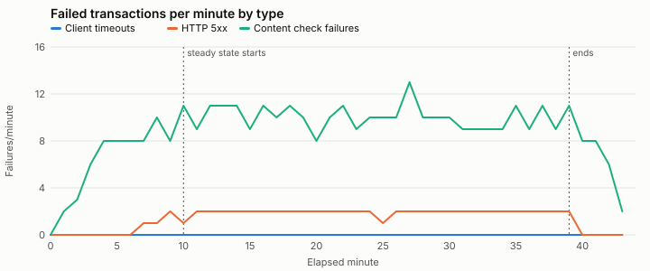

# Computed results summary — SYN-RUN-000

Generated by `tools/analyze.py (deterministic; no AI model involved)`. Every number here is calculated from the raw data files.

**Test objective:** Can the checkout journey support 500 concurrent users at 90+ transactions/second with checkout p95 at or under 2.0 seconds?

**Windows:** min 0-9, min 10-39, min 40-44 — Default windows: planned ramp-up, steady state split at the first minute any SLA fails, and ramp-down.

## Test run overview

| Item | Value |
| --- | --- |
| Test type | load |
| Build under test | syn-shop 4.12.0 |
| Changes since baseline | none listed |
| Baseline run | none |
| Environment parity: app tier | 2 app nodes; production runs 6 of the same size (one-third scale) |
| Environment parity: database | production-size copy, refreshed 2026-09-15; same instance class as production |
| Environment parity: payment provider | shared third-party sandbox; production uses the provider's live service |
| Environment parity: cache | warmed by a 10-minute ramp-up; no separate warm-up run |
| Runtime setting: think time | fixed 3 s before each step |
| Runtime setting: pacing | fixed 20 s |
| Runtime setting: client timeout s | 30 |
| Runtime setting: abort on error | True |
| LG1 | 4 vCPU, log level standard |
| LG2 | 4 vCPU, log level standard |
| Script | checkout_journey v1.8: every step checks for expected page text; correlation validated in a single-Vuser run on 2026-09-30 |
| Test data: customers | SYN-CUST-50K (50,000 accounts, reused across iterations) |
| Test data: products | SYN-SKU-5K (5,000 in-stock SKUs) |

## Transaction summary (steady state)

From `transaction_summary.csv`, the load tool's run-level summary. Response times are for passed transactions, in seconds.

| Load generator | Transaction | Count | Passed | Failed | Error % | Min | Avg | p90 | p95 | p99 | Max | Std dev |
| --- | --- | --- | --- | --- | --- | --- | --- | --- | --- | --- | --- | --- |
| LG1 | search | 45107 | 45018 | 89 | 0.20 | 0.11 | 0.60 | 0.89 | 1.01 | 1.28 | 2.21 | 0.22 |
| LG1 | add_to_cart | 22436 | 22393 | 43 | 0.19 | 0.10 | 0.40 | 0.59 | 0.67 | 0.86 | 1.68 | 0.15 |
| LG1 | checkout | 22619 | 22572 | 47 | 0.21 | 0.20 | 0.85 | 1.25 | 1.42 | 1.82 | 3.60 | 0.31 |
| LG2 | search | 45019 | 44925 | 94 | 0.21 | 0.14 | 0.60 | 0.89 | 1.01 | 1.28 | 2.50 | 0.22 |
| LG2 | add_to_cart | 22421 | 22381 | 40 | 0.18 | 0.10 | 0.40 | 0.59 | 0.67 | 0.85 | 1.76 | 0.14 |
| LG2 | checkout | 22513 | 22466 | 47 | 0.21 | 0.20 | 0.84 | 1.25 | 1.41 | 1.79 | 3.61 | 0.31 |
| ALL | search | 90126 | 89943 | 183 | 0.20 | 0.11 | 0.60 | 0.89 | 1.01 | 1.28 | 2.50 | 0.22 |
| ALL | add_to_cart | 44857 | 44774 | 83 | 0.19 | 0.10 | 0.40 | 0.59 | 0.67 | 0.86 | 1.76 | 0.14 |
| ALL | checkout | 45132 | 45038 | 94 | 0.21 | 0.20 | 0.85 | 1.25 | 1.42 | 1.81 | 3.61 | 0.31 |

## Graphs

## Errors by type

| Window | Load generator | Transactions | Failed | Client timeouts | HTTP 5xx | Content check failures |
| --- | --- | --- | --- | --- | --- | --- |
| min 0-9 | LG1 | 16547 | 34 | 0 | 3 | 31 |
| min 0-9 | LG2 | 16413 | 31 | 0 | 1 | 30 |
| min 10-39 | LG1 | 90162 | 179 | 0 | 28 | 151 |
| min 10-39 | LG2 | 89953 | 181 | 0 | 30 | 151 |
| min 40-44 | LG1 | 5991 | 12 | 0 | 0 | 12 |
| min 40-44 | LG2 | 5991 | 12 | 0 | 0 | 12 |

## SLA results (steady state)

First failing minute: None. Steady-state error rate: 0.2%.
SLA-1 is judged per generator per minute because p95 values cannot be averaged.

| Min | Checkout p95 by generator | SLA-1 | TPS | SLA-2 | Error % | SLA-3 |
| --- | --- | --- | --- | --- | --- | --- |
| 10 | LG1 1.39, LG2 1.42 | PASS | 100.5 | PASS | 0.2 | PASS |
| 11 | LG1 1.37, LG2 1.35 | PASS | 100.6 | PASS | 0.18 | PASS |
| 12 | LG1 1.4, LG2 1.41 | PASS | 101.2 | PASS | 0.21 | PASS |
| 13 | LG1 1.49, LG2 1.31 | PASS | 99.4 | PASS | 0.22 | PASS |
| 14 | LG1 1.45, LG2 1.35 | PASS | 99.8 | PASS | 0.22 | PASS |
| 15 | LG1 1.51, LG2 1.51 | PASS | 100.4 | PASS | 0.18 | PASS |
| 16 | LG1 1.41, LG2 1.44 | PASS | 100.0 | PASS | 0.22 | PASS |
| 17 | LG1 1.44, LG2 1.48 | PASS | 101.2 | PASS | 0.2 | PASS |
| 18 | LG1 1.39, LG2 1.4 | PASS | 99.2 | PASS | 0.22 | PASS |
| 19 | LG1 1.34, LG2 1.48 | PASS | 99.3 | PASS | 0.2 | PASS |
| 20 | LG1 1.4, LG2 1.33 | PASS | 99.5 | PASS | 0.17 | PASS |
| 21 | LG1 1.32, LG2 1.32 | PASS | 99.1 | PASS | 0.2 | PASS |
| 22 | LG1 1.33, LG2 1.47 | PASS | 99.9 | PASS | 0.22 | PASS |
| 23 | LG1 1.45, LG2 1.36 | PASS | 99.4 | PASS | 0.18 | PASS |
| 24 | LG1 1.49, LG2 1.39 | PASS | 100.8 | PASS | 0.2 | PASS |
| 25 | LG1 1.45, LG2 1.49 | PASS | 99.6 | PASS | 0.18 | PASS |
| 26 | LG1 1.44, LG2 1.36 | PASS | 98.6 | PASS | 0.2 | PASS |
| 27 | LG1 1.49, LG2 1.43 | PASS | 100.2 | PASS | 0.25 | PASS |
| 28 | LG1 1.45, LG2 1.4 | PASS | 100.2 | PASS | 0.2 | PASS |
| 29 | LG1 1.41, LG2 1.51 | PASS | 101.4 | PASS | 0.2 | PASS |
| 30 | LG1 1.44, LG2 1.31 | PASS | 100.1 | PASS | 0.2 | PASS |
| 31 | LG1 1.35, LG2 1.41 | PASS | 100.0 | PASS | 0.18 | PASS |
| 32 | LG1 1.36, LG2 1.43 | PASS | 101.7 | PASS | 0.18 | PASS |
| 33 | LG1 1.4, LG2 1.46 | PASS | 101.1 | PASS | 0.18 | PASS |
| 34 | LG1 1.54, LG2 1.31 | PASS | 99.8 | PASS | 0.18 | PASS |
| 35 | LG1 1.33, LG2 1.47 | PASS | 100.7 | PASS | 0.22 | PASS |
| 36 | LG1 1.38, LG2 1.45 | PASS | 98.3 | PASS | 0.19 | PASS |
| 37 | LG1 1.42, LG2 1.41 | PASS | 100.9 | PASS | 0.21 | PASS |
| 38 | LG1 1.37, LG2 1.5 | PASS | 99.5 | PASS | 0.18 | PASS |
| 39 | LG1 1.37, LG2 1.43 | PASS | 99.6 | PASS | 0.22 | PASS |
