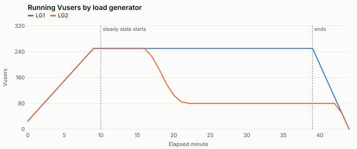
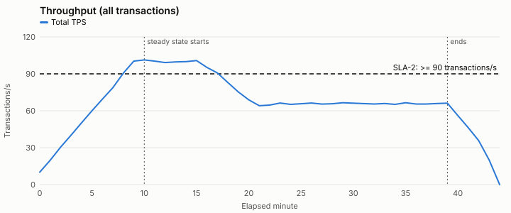
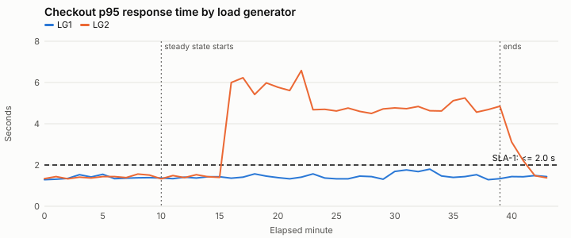
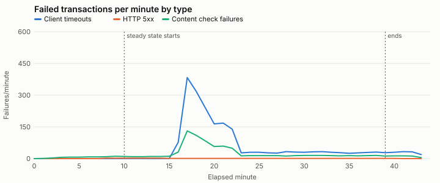

# Computed results summary — SYN-RUN-001

Generated by `tools/analyze.py (deterministic; no AI model involved)`. Every number here is calculated from the raw data files.

**Test objective:** Can the checkout journey support 500 concurrent users at 90+ transactions/second with checkout p95 at or under 2.0 seconds?

**Windows:** min 0-9, min 10-15, min 16-39, min 40-44 — Default windows: planned ramp-up, steady state split at the first minute any SLA fails, and ramp-down.

## Test run overview

| Item | Value |
| --- | --- |
| Test type | load |
| Build under test | syn-shop 4.13.0 |
| Changes since baseline | search ranking update, front-end bundle changes |
| Baseline run | SYN-RUN-000 (build 4.12.0) |
| Environment parity: app tier | 2 app nodes; production runs 6 of the same size (one-third scale) |
| Environment parity: database | production-size copy, refreshed 2026-09-15; same instance class as production |
| Environment parity: payment provider | shared third-party sandbox; production uses the provider's live service |
| Environment parity: cache | warmed by a 10-minute ramp-up; no separate warm-up run |
| Runtime setting: think time | fixed 3 s before each step |
| Runtime setting: pacing | fixed 20 s |
| Runtime setting: client timeout s | 30 |
| Runtime setting: abort on error | True |
| LG1 | 4 vCPU, log level standard |
| LG2 | 4 vCPU, log level extended (parameter substitution on) |
| Script | checkout_journey v1.8: every step checks for expected page text; correlation validated in a single-Vuser run on 2026-09-30 |
| Test data: customers | SYN-CUST-50K (50,000 accounts, reused across iterations) |
| Test data: products | SYN-SKU-5K (5,000 in-stock SKUs) |

## Transaction summary (steady state)

From `transaction_summary.csv`, the load tool's run-level summary. Response times are for passed transactions, in seconds.

| Load generator | Transaction | Count | Passed | Failed | Error % | Min | Avg | p90 | p95 | p99 | Max | Std dev |
| --- | --- | --- | --- | --- | --- | --- | --- | --- | --- | --- | --- | --- |
| LG1 | search | 45061 | 44971 | 90 | 0.20 | 0.13 | 0.60 | 0.89 | 1.01 | 1.27 | 2.41 | 0.22 |
| LG1 | add_to_cart | 22477 | 22429 | 48 | 0.21 | 0.10 | 0.40 | 0.59 | 0.67 | 0.85 | 1.43 | 0.15 |
| LG1 | checkout | 22527 | 22478 | 49 | 0.22 | 0.17 | 0.87 | 1.29 | 1.48 | 1.85 | 3.44 | 0.32 |
| LG2 | search | 22878 | 21569 | 1309 | 5.72 | 0.16 | 1.56 | 2.99 | 3.47 | 4.55 | 10.66 | 1.05 |
| LG2 | add_to_cart | 11374 | 10705 | 669 | 5.88 | 0.10 | 1.02 | 1.95 | 2.25 | 2.92 | 4.84 | 0.68 |
| LG2 | checkout | 11416 | 10744 | 672 | 5.89 | 0.24 | 2.18 | 4.15 | 4.83 | 6.45 | 12.92 | 1.47 |
| ALL | search | 67939 | 66540 | 1399 | 2.06 | 0.13 | 0.91 | 2.04 | 2.65 | 3.81 | 10.66 | 0.77 |
| ALL | add_to_cart | 33851 | 33134 | 717 | 2.12 | 0.10 | 0.60 | 1.34 | 1.74 | 2.48 | 4.84 | 0.50 |
| ALL | checkout | 33943 | 33222 | 721 | 2.12 | 0.17 | 1.29 | 2.87 | 3.70 | 5.31 | 12.92 | 1.07 |

## Graphs

## Baseline comparison: SYN-RUN-000 (build 4.12.0)

Compares this run with the baseline run. Baseline data is never used to fill gaps in this run. A transaction is flagged when p90 or p95 is more than 10% slower than the baseline.

**Not comparable. Shown for context only, not a regression verdict:** planned load not running in this run for 23 steady-state minutes (first at minute 17).

Steady-state throughput: 75.4 TPS against 100.1 TPS in the baseline (-24.7%).

| Transaction | Avg (base → now) | p90 (base → now) | p95 (base → now) | p99 (base → now) | Error % (base → now) | Regression |
| --- | --- | --- | --- | --- | --- | --- |
| search | 0.6 → 0.91 (+51.7%) | 0.89 → 2.04 (+129.2%) | 1.01 → 2.65 (+162.4%) | 1.28 → 3.81 (+197.7%) | 0.2 → 2.06 | n/a (not comparable) |
| add_to_cart | 0.4 → 0.6 (+50.0%) | 0.59 → 1.34 (+127.1%) | 0.67 → 1.74 (+159.7%) | 0.86 → 2.48 (+188.4%) | 0.19 → 2.12 | n/a (not comparable) |
| checkout | 0.85 → 1.29 (+51.8%) | 1.25 → 2.87 (+129.6%) | 1.42 → 3.7 (+160.6%) | 1.81 → 5.31 (+193.4%) | 0.21 → 2.12 | n/a (not comparable) |

## Errors by type

| Window | Load generator | Transactions | Failed | Client timeouts | HTTP 5xx | Content check failures |
| --- | --- | --- | --- | --- | --- | --- |
| min 0-9 | LG1 | 16489 | 32 | 0 | 2 | 30 |
| min 0-9 | LG2 | 16508 | 32 | 0 | 2 | 30 |
| min 10-15 | LG1 | 17972 | 38 | 0 | 6 | 32 |
| min 10-15 | LG2 | 18099 | 32 | 0 | 5 | 27 |
| min 16-39 | LG1 | 72093 | 149 | 0 | 24 | 125 |
| min 16-39 | LG2 | 27569 | 2618 | 1987 | 0 | 631 |
| min 40-44 | LG1 | 6005 | 12 | 0 | 1 | 11 |
| min 40-44 | LG2 | 3474 | 146 | 114 | 0 | 32 |

## SLA results (steady state)

Calculated from the data only; the Test Execution Analyst decides whether the run is valid enough to report these as SLA results. Thresholds come from scenario.json. A missing measurement is Not evaluated, never Pass. Response time SLAs are judged per load generator per minute because percentiles cannot be averaged. First minute any SLA failed: 16.

| SLA | Metric | Threshold | Evaluation | Result | Minutes Pass / Fail / Not evaluated | Window value | Notes |
| --- | --- | --- | --- | --- | --- | --- | --- |
| SLA-1 | checkout p95 response time | <= 2.0 s | per_minute_per_generator | **Fail** | 6 / 24 / 0 |  |  |
| SLA-2 | total throughput | >= 90 transactions/s | per_minute | **Fail** | 8 / 22 / 0 |  |  |
| SLA-3 | transaction error rate | <= 1% | window | **Fail** |  | 2.09 |  |

Per minute:

| Min | SLA-1 | SLA-2 | SLA-3 |
| --- | --- | --- | --- |
| 10 | LG1 1.37, LG2 1.33: Pass | 101.35: Pass | 0.2 (judged on window) |
| 11 | LG1 1.34, LG2 1.49: Pass | 100.32: Pass | 0.18 (judged on window) |
| 12 | LG1 1.41, LG2 1.39: Pass | 99.18: Pass | 0.18 (judged on window) |
| 13 | LG1 1.37, LG2 1.53: Pass | 99.67: Pass | 0.2 (judged on window) |
| 14 | LG1 1.43, LG2 1.43: Pass | 99.87: Pass | 0.2 (judged on window) |
| 15 | LG1 1.43, LG2 1.4: Pass | 100.8: Pass | 0.2 (judged on window) |
| 16 | LG1 1.36, LG2 6.0: Fail | 95.18: Pass | 1.91 (judged on window) |
| 17 | LG1 1.41, LG2 6.23: Fail | 90.7: Pass | 9.46 (judged on window) |
| 18 | LG1 1.57, LG2 5.42: Fail | 82.92: Fail | 8.62 (judged on window) |
| 19 | LG1 1.46, LG2 5.98: Fail | 75.32: Fail | 7.21 (judged on window) |
| 20 | LG1 1.39, LG2 5.77: Fail | 68.88: Fail | 5.37 (judged on window) |
| 21 | LG1 1.33, LG2 5.61: Fail | 64.12: Fail | 5.93 (judged on window) |
| 22 | LG1 1.41, LG2 6.58: Fail | 64.62: Fail | 4.87 (judged on window) |
| 23 | LG1 1.57, LG2 4.68: Fail | 66.27: Fail | 1.03 (judged on window) |
| 24 | LG1 1.37, LG2 4.7: Fail | 65.25: Fail | 1.15 (judged on window) |
| 25 | LG1 1.33, LG2 4.62: Fail | 65.67: Fail | 1.14 (judged on window) |
| 26 | LG1 1.33, LG2 4.76: Fail | 66.3: Fail | 1.06 (judged on window) |
| 27 | LG1 1.46, LG2 4.6: Fail | 65.42: Fail | 1.04 (judged on window) |
| 28 | LG1 1.44, LG2 4.5: Fail | 65.65: Fail | 1.17 (judged on window) |
| 29 | LG1 1.31, LG2 4.72: Fail | 66.48: Fail | 1.15 (judged on window) |
| 30 | LG1 1.69, LG2 4.77: Fail | 66.17: Fail | 1.16 (judged on window) |
| 31 | LG1 1.76, LG2 4.73: Fail | 65.83: Fail | 1.22 (judged on window) |
| 32 | LG1 1.68, LG2 4.84: Fail | 65.52: Fail | 1.25 (judged on window) |
| 33 | LG1 1.8, LG2 4.63: Fail | 65.9: Fail | 1.14 (judged on window) |
| 34 | LG1 1.47, LG2 4.62: Fail | 65.22: Fail | 1.07 (judged on window) |
| 35 | LG1 1.4, LG2 5.12: Fail | 66.5: Fail | 1.0 (judged on window) |
| 36 | LG1 1.44, LG2 5.25: Fail | 65.55: Fail | 1.04 (judged on window) |
| 37 | LG1 1.53, LG2 4.56: Fail | 65.45: Fail | 1.12 (judged on window) |
| 38 | LG1 1.29, LG2 4.69: Fail | 65.88: Fail | 1.19 (judged on window) |
| 39 | LG1 1.34, LG2 4.85: Fail | 66.25: Fail | 1.03 (judged on window) |
