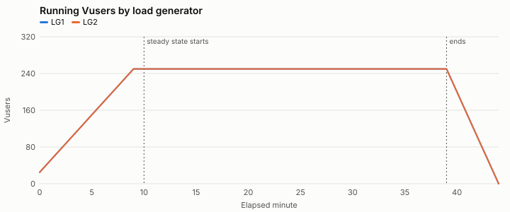
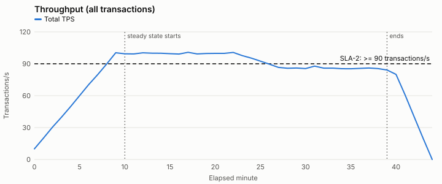
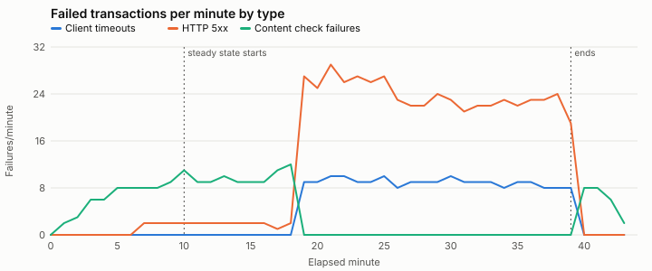

# Computed results summary — SYN-RUN-002

Generated by `tools/analyze.py (deterministic; no AI model involved)`. Every number here is calculated from the raw data files.

**Test objective:** Can the checkout journey support 500 concurrent users at 90+ transactions/second with checkout p95 at or under 2.0 seconds?

**Windows:** min 0-9, min 10-18, min 19-39, min 40-44 — Default windows: planned ramp-up, steady state split at the first minute any SLA fails, and ramp-down.

## Test run overview

| Item | Value |
| --- | --- |
| Test type | load |
| Build under test | syn-shop 4.13.0 |
| Changes since baseline | search ranking update, front-end bundle changes |
| Baseline run | SYN-RUN-000 (build 4.12.0) |
| Environment parity: app tier | 2 app nodes; production runs 6 of the same size (one-third scale) |
| Environment parity: database | production-size copy, refreshed 2026-09-15; same instance class as production |
| Environment parity: payment provider | shared third-party sandbox; production uses the provider's live service |
| Environment parity: cache | warmed by a 10-minute ramp-up; no separate warm-up run |
| Runtime setting: think time | fixed 3 s before each step |
| Runtime setting: pacing | fixed 20 s |
| Runtime setting: client timeout s | 30 |
| Runtime setting: abort on error | True |
| LG1 | 4 vCPU, log level standard |
| LG2 | 4 vCPU, log level standard |
| Script | checkout_journey v1.8: every step checks for expected page text; correlation validated in a single-Vuser run on 2026-09-30 |
| Test data: customers | SYN-CUST-50K (50,000 accounts, reused across iterations) |
| Test data: products | SYN-SKU-5K (5,000 in-stock SKUs) |

## Transaction summary (steady state)

From `transaction_summary.csv`, the load tool's run-level summary. Response times are for passed transactions, in seconds.

| Load generator | Transaction | Count | Passed | Failed | Error % | Min | Avg | p90 | p95 | p99 | Max | Std dev |
| --- | --- | --- | --- | --- | --- | --- | --- | --- | --- | --- | --- | --- |
| LG1 | search | 41981 | 41782 | 199 | 0.47 | 0.15 | 1.63 | 3.08 | 3.59 | 4.74 | 9.17 | 1.06 |
| LG1 | add_to_cart | 20821 | 20721 | 100 | 0.48 | 0.12 | 1.34 | 2.64 | 3.09 | 4.06 | 7.60 | 0.95 |
| LG1 | checkout | 20847 | 20748 | 99 | 0.47 | 0.22 | 2.91 | 5.36 | 6.24 | 8.10 | 16.82 | 1.89 |
| LG2 | search | 41809 | 41608 | 201 | 0.48 | 0.15 | 1.63 | 3.08 | 3.60 | 4.75 | 9.69 | 1.07 |
| LG2 | add_to_cart | 20962 | 20867 | 95 | 0.45 | 0.11 | 1.33 | 2.62 | 3.06 | 4.00 | 7.77 | 0.94 |
| LG2 | checkout | 20884 | 20784 | 100 | 0.48 | 0.23 | 2.95 | 5.43 | 6.33 | 8.24 | 15.65 | 1.93 |
| ALL | search | 83790 | 83390 | 400 | 0.48 | 0.15 | 1.63 | 3.08 | 3.60 | 4.74 | 9.69 | 1.07 |
| ALL | add_to_cart | 41783 | 41588 | 195 | 0.47 | 0.11 | 1.34 | 2.63 | 3.07 | 4.03 | 7.77 | 0.95 |
| ALL | checkout | 41731 | 41532 | 199 | 0.48 | 0.22 | 2.93 | 5.40 | 6.28 | 8.19 | 16.82 | 1.91 |

## Graphs

## Baseline comparison: SYN-RUN-000 (build 4.12.0)

Compares this run with the baseline run. Baseline data is never used to fill gaps in this run. A transaction is flagged when p90 or p95 is more than 10% slower than the baseline.

**Comparable:** same test design and environment, planned load running in both runs, complete data. The Test Execution Analyst still decides whether this run is valid.

Steady-state throughput: 92.9 TPS against 100.1 TPS in the baseline (-7.2%).

| Transaction | Avg (base → now) | p90 (base → now) | p95 (base → now) | p99 (base → now) | Error % (base → now) | Regression |
| --- | --- | --- | --- | --- | --- | --- |
| search | 0.6 → 1.63 (+171.7%) | 0.89 → 3.08 (+246.1%) | 1.01 → 3.6 (+256.4%) | 1.28 → 4.74 (+270.3%) | 0.2 → 0.48 | YES |
| add_to_cart | 0.4 → 1.34 (+235.0%) | 0.59 → 2.63 (+345.8%) | 0.67 → 3.07 (+358.2%) | 0.86 → 4.03 (+368.6%) | 0.19 → 0.47 | YES |
| checkout | 0.85 → 2.93 (+244.7%) | 1.25 → 5.4 (+332.0%) | 1.42 → 6.28 (+342.3%) | 1.81 → 8.19 (+352.5%) | 0.21 → 0.48 | YES |

## Errors by type

| Window | Load generator | Transactions | Failed | Client timeouts | HTTP 5xx | Content check failures |
| --- | --- | --- | --- | --- | --- | --- |
| min 0-9 | LG1 | 16480 | 31 | 0 | 3 | 28 |
| min 0-9 | LG2 | 16545 | 33 | 0 | 3 | 30 |
| min 10-18 | LG1 | 26960 | 56 | 0 | 9 | 47 |
| min 10-18 | LG2 | 26907 | 50 | 0 | 8 | 42 |
| min 19-39 | LG1 | 56689 | 342 | 93 | 249 | 0 |
| min 19-39 | LG2 | 56748 | 346 | 95 | 251 | 0 |
| min 40-44 | LG1 | 6021 | 12 | 0 | 0 | 12 |
| min 40-44 | LG2 | 6035 | 12 | 0 | 0 | 12 |

## Capacity: CPU-bound throughput ceiling (conditional estimate)

Utilization Law (U = X × D): CPU % per transaction/s, and the throughput each tier would reach at 80% CPU **if CPU were the only limit**. This is not the tier's capacity. When another resource is saturated, it limits throughput first. "No other monitored limit detected" does not prove CPU is the limit: unmonitored resources such as external APIs, the network or locks can still cap throughput. Only valid if CPU is the limiting resource. Also assumes even load balancing across app nodes and CPU that scales linearly with throughput. Applies to this test environment only; do not scale to production without stating the ratio.

| Window | Tier | Mean CPU % | TPS handled | CPU % per TPS | CPU-bound ceiling (TPS) | Other limits seen |
| --- | --- | --- | --- | --- | --- | --- |
| min 0-9 | app1 | 33.1 | 27.5 | 1.205 | 66.4 | no other monitored limit detected |
| min 0-9 | app2 | 33.4 | 27.5 | 1.214 | 65.9 | no other monitored limit detected |
| min 0-9 | database | 18.1 | 55.0 | 0.329 | 242.9 | not checked |
| min 10-18 | app1 | 52.8 | 49.9 | 1.058 | 75.6 | no other monitored limit detected |
| min 10-18 | app2 | 52.7 | 49.9 | 1.057 | 75.7 | no other monitored limit detected |
| min 10-18 | database | 27.9 | 99.8 | 0.28 | 286.0 | not checked |
| min 19-39 | app1 | 52.6 | 45.0 | 1.168 | 68.5 | **DB connection pool at its maximum in 20 of 21 minutes; mean DB pool wait 1411 ms; threads at 90% or more of maximum in 5 minutes: CPU is not the limiting resource; ceiling does not apply** |
| min 19-39 | app2 | 48.3 | 45.0 | 1.072 | 74.6 | **DB connection pool at its maximum in 20 of 21 minutes; mean DB pool wait 1396 ms; threads at 90% or more of maximum in 5 minutes: CPU is not the limiting resource; ceiling does not apply** |
| min 19-39 | database | 29.1 | 90.0 | 0.324 | 247.2 | not checked |
| min 40-44 | app1 | 30.2 | 25.1 | 1.201 | 66.6 | no other monitored limit detected |
| min 40-44 | app2 | 31.0 | 25.1 | 1.236 | 64.7 | no other monitored limit detected |
| min 40-44 | database | 16.4 | 50.2 | 0.327 | 244.7 | not checked |

## Input checks

All listed files loaded. No malformed values, timestamp mismatches or duplicate rows found.

## Data inventory

| File | Rows/lines | UTC range | Coverage | Missing minutes | Notes |
| --- | --- | --- | --- | --- | --- |
| transactions.csv | 264 | 2026-10-08T10:00:00Z → 2026-10-08T10:43:00Z | LG1 44/45 minutes; LG2 44/45 minutes | none | Percentiles are per generator per minute; they cannot be averaged into run-level percentiles. |
| transaction_summary.csv | 9 |  | steady state run-level summary | none |  |
| vusers.csv | 90 | 2026-10-08T10:00:00Z → 2026-10-08T10:44:00Z | LG1 45/45 minutes; LG2 45/45 minutes | none |  |
| load_generators.csv | 90 | 2026-10-08T10:00:00Z → 2026-10-08T10:44:00Z | LG1 45/45 minutes; LG2 45/45 minutes | none |  |
| app_servers.csv | 90 | 2026-10-08T10:00:00Z → 2026-10-08T10:44:00Z | app1 45/45 minutes; app2 45/45 minutes | none |  |
| database.csv | 45 | 2026-10-08T10:00:00Z → 2026-10-08T10:44:00Z | all 45/45 minutes | none | converted to UTC using the offset in each timestamp; Exported from the database host, not the APM tool. |
| network.csv | 45 | 2026-10-08T10:00:00Z → 2026-10-08T10:44:00Z | lb1 45/45 minutes | none |  |
| external_calls.csv | 45 | 2026-10-08T10:00:00Z → 2026-10-08T10:44:00Z | payment-sandbox 45/45 minutes | none |  |
| checkout_traces.csv | 132 | 2026-10-08T10:00:10Z → 2026-10-08T10:43:44Z |  | none | Sample, not every request. |

## Load profile by minute

| Min | Scheduled Vusers | Running Vusers | Exited on error | TPS | Error % | Implied cycle (s) |
| --- | --- | --- | --- | --- | --- | --- |
| 0 | 50 | 50 | 0 | 10.0 | 0.0 | 20.0 |
| 1 | 100 | 100 | 0 | 20.0 | 0.17 | 20.1 |
| 2 | 150 | 150 | 0 | 30.4 | 0.16 | 19.9 |
| 3 | 200 | 200 | 0 | 39.8 | 0.25 | 20.5 |
| 4 | 250 | 250 | 0 | 49.7 | 0.2 | 20.2 |
| 5 | 300 | 300 | 0 | 60.0 | 0.22 | 20.1 |
| 6 | 350 | 350 | 0 | 70.4 | 0.19 | 20.1 |
| 7 | 400 | 400 | 0 | 79.8 | 0.21 | 19.8 |
| 8 | 450 | 450 | 0 | 89.8 | 0.19 | 19.9 |
| 9 | 500 | 500 | 0 | 100.4 | 0.18 | 19.7 |
| 10 | 500 | 500 | 0 | 99.4 | 0.22 | 19.8 |
| 11 | 500 | 500 | 0 | 99.3 | 0.18 | 20.3 |
| 12 | 500 | 500 | 0 | 100.3 | 0.18 | 19.9 |
| 13 | 500 | 500 | 0 | 100.0 | 0.2 | 20.2 |
| 14 | 500 | 500 | 0 | 99.9 | 0.18 | 19.9 |
| 15 | 500 | 500 | 0 | 99.5 | 0.18 | 20.2 |
| 16 | 500 | 500 | 0 | 99.2 | 0.18 | 20.2 |
| 17 | 500 | 500 | 0 | 100.8 | 0.2 | 19.5 |
| 18 | 500 | 500 | 0 | 99.3 | 0.23 | 20.1 |
| 19 | 500 | 500 | 0 | 99.7 | 0.6 | 19.9 |
| 20 | 500 | 500 | 0 | 99.8 | 0.57 | 20.3 |
| 21 | 500 | 500 | 0 | 99.8 | 0.65 | 20.5 |
| 22 | 500 | 500 | 0 | 100.7 | 0.6 | 19.8 |
| 23 | 500 | 500 | 0 | 97.7 | 0.61 | 20.5 |
| 24 | 500 | 500 | 0 | 95.3 | 0.61 | 21.3 |
| 25 | 500 | 500 | 0 | 92.5 | 0.67 | 21.5 |
| 26 | 500 | 500 | 0 | 89.6 | 0.58 | 22.4 |
| 27 | 500 | 500 | 0 | 86.6 | 0.6 | 23.0 |
| 28 | 500 | 500 | 0 | 85.8 | 0.6 | 23.0 |
| 29 | 500 | 500 | 0 | 86.0 | 0.64 | 23.7 |
| 30 | 500 | 500 | 0 | 85.5 | 0.64 | 23.2 |
| 31 | 500 | 500 | 0 | 87.8 | 0.57 | 22.7 |
| 32 | 500 | 500 | 0 | 85.9 | 0.6 | 23.6 |
| 33 | 500 | 500 | 0 | 85.9 | 0.6 | 23.1 |
| 34 | 500 | 500 | 0 | 85.4 | 0.6 | 23.7 |
| 35 | 500 | 500 | 0 | 85.3 | 0.61 | 24.0 |
| 36 | 500 | 500 | 0 | 85.7 | 0.62 | 23.5 |
| 37 | 500 | 500 | 0 | 86.0 | 0.6 | 23.4 |
| 38 | 500 | 500 | 0 | 85.5 | 0.62 | 23.7 |
| 39 | 500 | 500 | 0 | 84.2 | 0.53 | 23.8 |
| 40 | 400 | 400 | 0 | 80.0 | 0.17 | 19.6 |
| 41 | 300 | 300 | 0 | 60.8 | 0.22 | 20.0 |
| 42 | 200 | 200 | 0 | 40.3 | 0.25 | 19.5 |
| 43 | 100 | 100 | 0 | 19.8 | 0.17 | 20.1 |
| 44 | 0 | 0 | 0 | 0.0 | None | None |

Pacing: 20.0s. implied_cycle_s = running users / iterations per second (one checkout per iteration). With fixed pacing it should equal the pacing interval; a larger value means iterations are running late (responses + think time exceed pacing).

### Throughput by generator (TPS)

- LG1: 0:5.0, 1:9.9, 2:15.1, 3:19.9, 4:24.9, 5:30.1, 6:35.1, 7:39.6, 8:45.1, 9:49.8, 10:49.5, 11:49.8, 12:50.1, 13:50.2, 14:49.6, 15:50.3, 16:49.5, 17:50.5, 18:49.7, 19:49.9, 20:50.1, 21:50.2, 22:50.5, 23:48.4, 24:47.4, 25:46.3, 26:44.7, 27:42.6, 28:43.0, 29:42.7, 30:42.4, 31:44.1, 32:43.3, 33:43.4, 34:42.4, 35:42.6, 36:42.6, 37:43.4, 38:43.0, 39:41.9, 40:40.2, 41:30.5, 42:19.8, 43:9.9
- LG2: 0:4.9, 1:10.1, 2:15.3, 3:19.9, 4:24.8, 5:29.9, 6:35.3, 7:40.2, 8:44.7, 9:50.6, 10:49.8, 11:49.6, 12:50.2, 13:49.8, 14:50.3, 15:49.2, 16:49.7, 17:50.4, 18:49.6, 19:49.8, 20:49.7, 21:49.5, 22:50.2, 23:49.3, 24:47.9, 25:46.1, 26:44.8, 27:44.0, 28:42.8, 29:43.3, 30:43.1, 31:43.8, 32:42.7, 33:42.5, 34:42.9, 35:42.8, 36:43.1, 37:42.6, 38:42.5, 39:42.3, 40:39.8, 41:30.3, 42:20.5, 43:10.0

## SLA results (steady state)

**Candidate results, pending the test validity result.** Calculated from the data only; the Test Execution Analyst decides whether the run is valid enough to report these as SLA results. Thresholds come from scenario.json. A missing measurement is Not evaluated, never Pass. Response time SLAs are judged per load generator per minute because percentiles cannot be averaged. First minute any SLA failed: 19.

| SLA | Metric | Threshold | Evaluation | Result | Minutes Pass / Fail / Not evaluated | Window value | Notes |
| --- | --- | --- | --- | --- | --- | --- | --- |
| SLA-1 | checkout p95 response time | <= 2.0 s | per_minute_per_generator | **Fail** | 9 / 21 / 0 |  |  |
| SLA-2 | total throughput | >= 90 transactions/s | per_minute | **Fail** | 16 / 14 / 0 |  |  |
| SLA-3 | transaction error rate | <= 1% | window | **Pass** |  | 0.47 |  |

Per minute:

| Min | SLA-1 | SLA-2 | SLA-3 |
| --- | --- | --- | --- |
| 10 | LG1 1.45, LG2 1.36: Pass | 99.37: Pass | 0.22 (judged on window) |
| 11 | LG1 1.41, LG2 1.4: Pass | 99.33: Pass | 0.18 (judged on window) |
| 12 | LG1 1.38, LG2 1.37: Pass | 100.3: Pass | 0.18 (judged on window) |
| 13 | LG1 1.34, LG2 1.39: Pass | 100.02: Pass | 0.2 (judged on window) |
| 14 | LG1 1.54, LG2 1.43: Pass | 99.9: Pass | 0.18 (judged on window) |
| 15 | LG1 1.39, LG2 1.42: Pass | 99.48: Pass | 0.18 (judged on window) |
| 16 | LG1 1.36, LG2 1.42: Pass | 99.22: Pass | 0.18 (judged on window) |
| 17 | LG1 1.41, LG2 1.52: Pass | 100.85: Pass | 0.2 (judged on window) |
| 18 | LG1 1.5, LG2 1.46: Pass | 99.32: Pass | 0.23 (judged on window) |
| 19 | LG1 5.07, LG2 5.08: Fail | 99.67: Pass | 0.6 (judged on window) |
| 20 | LG1 4.79, LG2 5.06: Fail | 99.82: Pass | 0.57 (judged on window) |
| 21 | LG1 5.24, LG2 5.33: Fail | 99.8: Pass | 0.65 (judged on window) |
| 22 | LG1 6.05, LG2 5.68: Fail | 100.67: Pass | 0.6 (judged on window) |
| 23 | LG1 5.78, LG2 6.08: Fail | 97.68: Pass | 0.61 (judged on window) |
| 24 | LG1 5.88, LG2 5.64: Fail | 95.35: Pass | 0.61 (judged on window) |
| 25 | LG1 6.29, LG2 6.52: Fail | 92.45: Pass | 0.67 (judged on window) |
| 26 | LG1 6.37, LG2 7.26: Fail | 89.58: Fail | 0.58 (judged on window) |
| 27 | LG1 7.19, LG2 7.34: Fail | 86.63: Fail | 0.6 (judged on window) |
| 28 | LG1 6.35, LG2 6.85: Fail | 85.75: Fail | 0.6 (judged on window) |
| 29 | LG1 7.39, LG2 6.79: Fail | 86.0: Fail | 0.64 (judged on window) |
| 30 | LG1 7.29, LG2 6.76: Fail | 85.5: Fail | 0.64 (judged on window) |
| 31 | LG1 6.59, LG2 6.91: Fail | 87.83: Fail | 0.57 (judged on window) |
| 32 | LG1 7.23, LG2 7.01: Fail | 85.93: Fail | 0.6 (judged on window) |
| 33 | LG1 7.28, LG2 7.64: Fail | 85.87: Fail | 0.6 (judged on window) |
| 34 | LG1 6.89, LG2 7.67: Fail | 85.4: Fail | 0.6 (judged on window) |
| 35 | LG1 6.99, LG2 7.55: Fail | 85.32: Fail | 0.61 (judged on window) |
| 36 | LG1 7.2, LG2 7.41: Fail | 85.65: Fail | 0.62 (judged on window) |
| 37 | LG1 6.84, LG2 7.28: Fail | 86.03: Fail | 0.6 (judged on window) |
| 38 | LG1 7.18, LG2 7.41: Fail | 85.5: Fail | 0.62 (judged on window) |
| 39 | LG1 7.43, LG2 7.45: Fail | 84.18: Fail | 0.53 (judged on window) |

## Metrics by time window

Percentile columns show the median and max of per-minute values — not a recomputed percentile.

### transactions.csv

**min 0-9**

- LG1 / add_to_cart: minutes_present 10; count 77.0/414.6/750.0; passed 77.0/413.9/749.0; failed 0.0/0.7/1.0; failed_timeout 0.0/0.0/0.0; failed_http_5xx 0.0/0.0/0.0; failed_content_check 0.0/0.7/1.0; min_s 0.09/0.13/0.17; avg_s 0.38/0.4/0.42; p90_s 0.59/0.63; p95_s 0.67/0.7; p99_s 0.84/0.95; max_s 0.87/1.07/1.56
- LG1 / checkout: minutes_present 10; count 75.0/410.6/753.0; passed 75.0/409.9/752.0; failed 0.0/0.7/1.0; failed_timeout 0.0/0.0/0.0; failed_http_5xx 0.0/0.0/0.0; failed_content_check 0.0/0.7/1.0; min_s 0.19/0.29/0.37; avg_s 0.82/0.85/0.89; p90_s 1.26/1.32; p95_s 1.4/1.52; p99_s 1.73/2.04; max_s 1.67/2.11/2.4
- LG1 / search: minutes_present 10; count 150.0/822.8/1487.0; passed 150.0/821.1/1484.0; failed 0.0/1.7/3.0; failed_timeout 0.0/0.0/0.0; failed_http_5xx 0.0/0.3/1.0; failed_content_check 0.0/1.4/2.0; min_s 0.15/0.17/0.24; avg_s 0.58/0.6/0.64; p90_s 0.88/0.92; p95_s 1.01/1.09; p99_s 1.28/1.5; max_s 1.37/1.71/2.01
- LG2 / add_to_cart: minutes_present 10; count 75.0/410.3/739.0; passed 75.0/409.4/737.0; failed 0.0/0.9/2.0; failed_timeout 0.0/0.0/0.0; failed_http_5xx 0.0/0.0/0.0; failed_content_check 0.0/0.9/2.0; min_s 0.1/0.13/0.18; avg_s 0.36/0.4/0.42; p90_s 0.58/0.63; p95_s 0.66/0.71; p99_s 0.86/0.99; max_s 0.72/1.05/1.29
- LG2 / checkout: minutes_present 10; count 75.0/415.6/772.0; passed 75.0/414.9/771.0; failed 0.0/0.7/1.0; failed_timeout 0.0/0.0/0.0; failed_http_5xx 0.0/0.0/0.0; failed_content_check 0.0/0.7/1.0; min_s 0.24/0.3/0.36; avg_s 0.81/0.85/0.9; p90_s 1.28/1.34; p95_s 1.46/1.53; p99_s 1.8/2.05; max_s 1.97/2.45/3.11
- LG2 / search: minutes_present 10; count 146.0/828.6/1523.0; passed 146.0/826.9/1520.0; failed 0.0/1.7/3.0; failed_timeout 0.0/0.0/0.0; failed_http_5xx 0.0/0.3/1.0; failed_content_check 0.0/1.4/2.0; min_s 0.14/0.18/0.21; avg_s 0.57/0.6/0.62; p90_s 0.88/0.93; p95_s 1.02/1.06; p99_s 1.29/1.53; max_s 1.4/1.77/2.2

**min 10-18**

- LG1 / add_to_cart: minutes_present 9; count 728.0/742.11/759.0; passed 726.0/740.56/757.0; failed 1.0/1.56/2.0; failed_timeout 0.0/0.0/0.0; failed_http_5xx 0.0/0.0/0.0; failed_content_check 1.0/1.56/2.0; min_s 0.12/0.14/0.15; avg_s 0.39/0.4/0.41; p90_s 0.59/0.61; p95_s 0.66/0.7; p99_s 0.83/0.87; max_s 0.95/1.19/1.62
- LG1 / checkout: minutes_present 9; count 728.0/751.0/769.0; passed 727.0/749.56/768.0; failed 1.0/1.44/2.0; failed_timeout 0.0/0.0/0.0; failed_http_5xx 0.0/0.0/0.0; failed_content_check 1.0/1.44/2.0; min_s 0.22/0.26/0.29; avg_s 0.82/0.85/0.9; p90_s 1.25/1.35; p95_s 1.41/1.54; p99_s 1.73/1.93; max_s 1.98/2.35/2.72
- LG1 / search: minutes_present 9; count 1474.0/1502.44/1537.0; passed 1471.0/1499.22/1534.0; failed 3.0/3.22/4.0; failed_timeout 0.0/0.0/0.0; failed_http_5xx 1.0/1.0/1.0; failed_content_check 2.0/2.22/3.0; min_s 0.15/0.18/0.21; avg_s 0.57/0.6/0.64; p90_s 0.88/0.94; p95_s 1.0/1.08; p99_s 1.29/1.38; max_s 1.64/2.0/2.45
- LG2 / add_to_cart: minutes_present 9; count 732.0/749.0/771.0; passed 730.0/747.67/769.0; failed 1.0/1.33/2.0; failed_timeout 0.0/0.0/0.0; failed_http_5xx 0.0/0.0/0.0; failed_content_check 1.0/1.33/2.0; min_s 0.11/0.13/0.15; avg_s 0.39/0.4/0.42; p90_s 0.59/0.61; p95_s 0.67/0.69; p99_s 0.84/0.93; max_s 0.98/1.06/1.14
- LG2 / checkout: minutes_present 9; count 729.0/748.67/772.0; passed 727.0/747.33/771.0; failed 1.0/1.33/2.0; failed_timeout 0.0/0.0/0.0; failed_http_5xx 0.0/0.0/0.0; failed_content_check 1.0/1.33/2.0; min_s 0.23/0.27/0.31; avg_s 0.81/0.85/0.88; p90_s 1.25/1.32; p95_s 1.42/1.52; p99_s 1.81/1.97; max_s 1.9/2.37/2.91
- LG2 / search: minutes_present 9; count 1468.0/1492.0/1527.0; passed 1465.0/1489.11/1524.0; failed 2.0/2.89/3.0; failed_timeout 0.0/0.0/0.0; failed_http_5xx 0.0/0.89/1.0; failed_content_check 2.0/2.0/2.0; min_s 0.15/0.19/0.22; avg_s 0.57/0.6/0.63; p90_s 0.89/0.96; p95_s 1.01/1.07; p99_s 1.28/1.43; max_s 1.59/1.83/2.07

**min 19-39**

- LG1 / add_to_cart: minutes_present 21; count 630.0/673.43/758.0; passed 626.0/669.33/753.0; failed 3.0/4.1/5.0; failed_timeout 1.0/1.0/1.0; failed_http_5xx 2.0/3.1/4.0; failed_content_check 0.0/0.0/0.0; min_s 0.2/0.6/0.86; avg_s 0.67/1.82/2.23; p90_s 3.04/3.4; p95_s 3.44/3.84; p99_s 4.29/4.91; max_s 1.73/5.19/7.6
- LG1 / checkout: minutes_present 21; count 619.0/670.86/771.0; passed 616.0/666.76/766.0; failed 3.0/4.1/5.0; failed_timeout 1.0/1.0/1.0; failed_http_5xx 2.0/3.1/4.0; failed_content_check 0.0/0.0/0.0; min_s 0.72/1.26/1.59; avg_s 2.93/3.94/4.47; p90_s 6.09/6.72; p95_s 6.84/7.43; p99_s 8.56/10.34; max_s 7.49/11.01/16.82
- LG1 / search: minutes_present 21; count 1252.0/1355.19/1539.0; passed 1245.0/1347.1/1529.0; failed 6.0/8.1/10.0; failed_timeout 2.0/2.43/3.0; failed_http_5xx 4.0/5.67/7.0; failed_content_check 0.0/0.0/0.0; min_s 0.29/0.66/0.9; avg_s 0.91/2.15/2.65; p90_s 3.58/3.94; p95_s 4.04/4.4; p99_s 5.11/5.78; max_s 3.33/6.27/9.17
- LG2 / add_to_cart: minutes_present 21; count 625.0/677.19/763.0; passed 621.0/673.24/759.0; failed 3.0/3.95/5.0; failed_timeout 1.0/1.0/1.0; failed_http_5xx 2.0/2.95/4.0; failed_content_check 0.0/0.0/0.0; min_s 0.22/0.59/0.79; avg_s 0.72/1.8/2.22; p90_s 3.07/3.3; p95_s 3.41/3.74; p99_s 4.27/4.71; max_s 2.11/4.96/7.77
- LG2 / checkout: minutes_present 21; count 625.0/673.62/757.0; passed 621.0/669.43/752.0; failed 3.0/4.19/5.0; failed_timeout 1.0/1.0/1.0; failed_http_5xx 2.0/3.19/4.0; failed_content_check 0.0/0.0/0.0; min_s 0.87/1.26/1.64; avg_s 3.01/3.98/4.58; p90_s 6.12/6.82; p95_s 6.91/7.67; p99_s 8.73/10.09; max_s 7.46/11.23/15.65
- LG2 / search: minutes_present 21; count 1257.0/1351.48/1513.0; passed 1248.0/1343.14/1502.0; failed 6.0/8.33/11.0; failed_timeout 2.0/2.52/3.0; failed_http_5xx 4.0/5.81/8.0; failed_content_check 0.0/0.0/0.0; min_s 0.31/0.62/0.91; avg_s 0.93/2.16/2.63; p90_s 3.53/3.9; p95_s 3.99/4.45; p99_s 5.05/5.57; max_s 2.77/6.5/9.69

**min 40-44**

- LG1 / add_to_cart: minutes_present 4; count 149.0/380.25/612.0; passed 149.0/379.5/611.0; failed 0.0/0.75/1.0; failed_timeout 0.0/0.0/0.0; failed_http_5xx 0.0/0.0/0.0; failed_content_check 0.0/0.75/1.0; min_s 0.14/0.15/0.16; avg_s 0.4/0.41/0.43; p90_s 0.6/0.65; p95_s 0.69/0.74; p99_s 0.93/0.93; max_s 0.97/1.02/1.14
- LG1 / checkout: minutes_present 4; count 147.0/379.0/618.0; passed 147.0/378.25/617.0; failed 0.0/0.75/1.0; failed_timeout 0.0/0.0/0.0; failed_http_5xx 0.0/0.0/0.0; failed_content_check 0.0/0.75/1.0; min_s 0.26/0.3/0.35; avg_s 0.82/0.85/0.87; p90_s 1.25/1.29; p95_s 1.44/1.52; p99_s 1.81/1.98; max_s 1.86/2.13/2.57
- LG1 / search: minutes_present 4; count 296.0/746.0/1182.0; passed 295.0/744.5/1180.0; failed 1.0/1.5/2.0; failed_timeout 0.0/0.0/0.0; failed_http_5xx 0.0/0.0/0.0; failed_content_check 1.0/1.5/2.0; min_s 0.18/0.21/0.22; avg_s 0.6/0.61/0.62; p90_s 0.88/0.9; p95_s 1.0/1.03; p99_s 1.27/1.35; max_s 1.78/1.98/2.18
- LG2 / add_to_cart: minutes_present 4; count 152.0/377.75/598.0; passed 152.0/377.0/597.0; failed 0.0/0.75/1.0; failed_timeout 0.0/0.0/0.0; failed_http_5xx 0.0/0.0/0.0; failed_content_check 0.0/0.75/1.0; min_s 0.13/0.14/0.16; avg_s 0.39/0.41/0.42; p90_s 0.59/0.62; p95_s 0.7/0.71; p99_s 0.88/1.01; max_s 0.98/1.15/1.38
- LG2 / checkout: minutes_present 4; count 151.0/381.0/608.0; passed 151.0/380.25/607.0; failed 0.0/0.75/1.0; failed_timeout 0.0/0.0/0.0; failed_http_5xx 0.0/0.0/0.0; failed_content_check 0.0/0.75/1.0; min_s 0.31/0.33/0.34; avg_s 0.83/0.85/0.88; p90_s 1.24/1.31; p95_s 1.42/1.47; p99_s 1.79/1.83; max_s 1.9/2.12/2.36
- LG2 / search: minutes_present 4; count 295.0/750.0/1181.0; passed 294.0/748.5/1179.0; failed 1.0/1.5/2.0; failed_timeout 0.0/0.0/0.0; failed_http_5xx 0.0/0.0/0.0; failed_content_check 1.0/1.5/2.0; min_s 0.19/0.2/0.22; avg_s 0.56/0.59/0.61; p90_s 0.88/0.89; p95_s 0.98/0.99; p99_s 1.25/1.29; max_s 1.34/1.6/1.86

(values are min/mean/max, or median/max for percentiles)

### vusers.csv

**min 0-9**

- LG1: minutes_present 10; scheduled_vusers 25.0/137.5/250.0; running_vusers 25.0/137.5/250.0; exited_with_error 0.0/0.0/0.0
- LG2: minutes_present 10; scheduled_vusers 25.0/137.5/250.0; running_vusers 25.0/137.5/250.0; exited_with_error 0.0/0.0/0.0

**min 10-18**

- LG1: minutes_present 9; scheduled_vusers 250.0/250.0/250.0; running_vusers 250.0/250.0/250.0; exited_with_error 0.0/0.0/0.0
- LG2: minutes_present 9; scheduled_vusers 250.0/250.0/250.0; running_vusers 250.0/250.0/250.0; exited_with_error 0.0/0.0/0.0

**min 19-39**

- LG1: minutes_present 21; scheduled_vusers 250.0/250.0/250.0; running_vusers 250.0/250.0/250.0; exited_with_error 0.0/0.0/0.0
- LG2: minutes_present 21; scheduled_vusers 250.0/250.0/250.0; running_vusers 250.0/250.0/250.0; exited_with_error 0.0/0.0/0.0

**min 40-44**

- LG1: minutes_present 5; scheduled_vusers 0.0/100.0/200.0; running_vusers 0.0/100.0/200.0; exited_with_error 0.0/0.0/0.0
- LG2: minutes_present 5; scheduled_vusers 0.0/100.0/200.0; running_vusers 0.0/100.0/200.0; exited_with_error 0.0/0.0/0.0

(values are min/mean/max, or median/max for percentiles)

### load_generators.csv

**min 0-9**

- LG1: minutes_present 10; cpu_pct 18.5/30.9/44.6; memory_pct 38.2/46.95/53.8; script_errors 0.0/0.0/0.0
- LG2: minutes_present 10; cpu_pct 18.4/30.29/46.0; memory_pct 40.9/47.45/54.8; script_errors 0.0/0.0/0.0

**min 10-18**

- LG1: minutes_present 9; cpu_pct 42.1/44.19/45.5; memory_pct 53.3/54.5/56.1; script_errors 0.0/0.0/0.0
- LG2: minutes_present 9; cpu_pct 42.0/43.84/45.5; memory_pct 53.2/54.68/56.1; script_errors 0.0/0.0/0.0

**min 19-39**

- LG1: minutes_present 21; cpu_pct 42.1/43.79/45.9; memory_pct 54.0/55.09/56.6; script_errors 0.0/1.19/2.0
- LG2: minutes_present 21; cpu_pct 42.2/43.99/45.6; memory_pct 53.7/55.3/56.9; script_errors 0.0/1.19/2.0

**min 40-44**

- LG1: minutes_present 5; cpu_pct 15.2/25.82/39.2; memory_pct 40.5/46.62/52.5; script_errors 0.0/0.0/0.0
- LG2: minutes_present 5; cpu_pct 15.0/26.2/39.1; memory_pct 40.8/46.56/51.5; script_errors 0.0/0.0/0.0

(values are min/mean/max, or median/max for percentiles)

### app_servers.csv

**min 0-9**

- app1: minutes_present 10; cpu_pct 13.6/33.15/53.6; heap_used_pct 55.6/58.46/61.7; gc_pause_ms 74.0/93.3/121.0; active_threads 10.0/16.0/22.0; max_threads 200.0/200.0/200.0; db_pool_active 3.0/5.1/7.0; db_pool_max 20.0/20.0/20.0; db_pool_wait_ms 0.0/1.1/2.0
- app2: minutes_present 10; cpu_pct 11.6/33.42/55.0; heap_used_pct 55.3/57.81/59.9; gc_pause_ms 77.0/107.5/134.0; active_threads 5.0/15.7/26.0; max_threads 200.0/200.0/200.0; db_pool_active 3.0/5.1/8.0; db_pool_max 20.0/20.0/20.0; db_pool_wait_ms 0.0/0.9/2.0

**min 10-18**

- app1: minutes_present 9; cpu_pct 50.7/52.76/54.3; heap_used_pct 54.4/56.22/60.6; gc_pause_ms 65.0/98.44/128.0; active_threads 21.0/23.56/26.0; max_threads 200.0/200.0/200.0; db_pool_active 6.0/7.0/8.0; db_pool_max 20.0/20.0/20.0; db_pool_wait_ms 0.0/0.89/2.0
- app2: minutes_present 9; cpu_pct 51.4/52.72/54.6; heap_used_pct 55.4/58.4/60.8; gc_pause_ms 73.0/108.44/128.0; active_threads 21.0/23.0/26.0; max_threads 200.0/200.0/200.0; db_pool_active 6.0/7.0/8.0; db_pool_max 20.0/20.0/20.0; db_pool_wait_ms 0.0/0.89/2.0

**min 19-39**

- app1: minutes_present 21; cpu_pct 49.0/52.59/55.0; heap_used_pct 55.4/74.58/86.1; gc_pause_ms 76.0/479.05/860.0; active_threads 37.0/127.43/200.0; max_threads 200.0/200.0/200.0; db_pool_active 17.0/19.86/20.0; db_pool_max 20.0/20.0/20.0; db_pool_wait_ms 322.0/1410.71/1818.0
- app2: minutes_present 21; cpu_pct 44.9/48.25/54.8; heap_used_pct 55.2/57.8/61.3; gc_pause_ms 67.0/98.67/132.0; active_threads 36.0/127.9/200.0; max_threads 200.0/200.0/200.0; db_pool_active 17.0/19.86/20.0; db_pool_max 20.0/20.0/20.0; db_pool_wait_ms 294.0/1395.86/1805.0

**min 40-44**

- app1: minutes_present 5; cpu_pct 8.3/25.8/44.1; heap_used_pct 54.6/58.94/61.6; gc_pause_ms 86.0/106.4/128.0; active_threads 5.0/13.6/21.0; max_threads 200.0/200.0/200.0; db_pool_active 3.0/4.6/6.0; db_pool_max 20.0/20.0/20.0; db_pool_wait_ms 0.0/1.2/2.0
- app2: minutes_present 5; cpu_pct 8.7/26.58/44.0; heap_used_pct 56.3/57.76/61.8; gc_pause_ms 65.0/108.6/130.0; active_threads 4.0/12.2/21.0; max_threads 200.0/200.0/200.0; db_pool_active 2.0/3.8/6.0; db_pool_max 20.0/20.0/20.0; db_pool_wait_ms 1.0/1.6/2.0

(values are min/mean/max, or median/max for percentiles)

### database.csv

**min 0-9**

- all: minutes_present 10; cpu_pct 6.9/18.13/28.7; active_sessions 4.0/6.8/10.0; avg_query_ms 10.2/10.94/12.3; lock_wait_ms 2.0/4.7/8.0

**min 10-18**

- all: minutes_present 9; cpu_pct 27.1/27.9/29.7; active_sessions 9.0/9.33/10.0; avg_query_ms 10.1/10.93/12.4; lock_wait_ms 2.0/3.67/5.0

**min 19-39**

- all: minutes_present 21; cpu_pct 24.1/29.14/44.0; active_sessions 9.0/39.67/46.0; avg_query_ms 10.1/13.11/21.1; lock_wait_ms 2.0/147.14/850.0

**min 40-44**

- all: minutes_present 5; cpu_pct 7.0/14.54/22.2; active_sessions 4.0/6.0/8.0; avg_query_ms 10.5/10.82/11.9; lock_wait_ms 3.0/5.4/6.0

(values are min/mean/max, or median/max for percentiles)

### network.csv

**min 0-9**

- lb1: minutes_present 10; active_connections 26.0/169.0/308.0; throughput_mbps 4.5/23.29/41.8; retransmit_pct 0.02/0.02/0.03

**min 10-18**

- lb1: minutes_present 9; active_connections 307.0/309.89/313.0; throughput_mbps 41.2/41.78/42.6; retransmit_pct 0.01/0.03/0.04

**min 19-39**

- lb1: minutes_present 21; active_connections 305.0/308.95/314.0; throughput_mbps 35.0/37.8/42.4; retransmit_pct 0.01/0.02/0.04

**min 40-44**

- lb1: minutes_present 5; active_connections 0.0/124.8/250.0; throughput_mbps -0.3/16.96/33.1; retransmit_pct 0.01/0.02/0.03

(values are min/mean/max, or median/max for percentiles)

### external_calls.csv

**min 0-9**

- payment-sandbox: minutes_present 10; calls 150.0/826.2/1525.0; avg_ms 234.0/248.4/259.0; p95_ms 360.5/381.0; errors 0.0/0.0/0.0

**min 10-18**

- payment-sandbox: minutes_present 9; calls 1477.0/1499.67/1538.0; avg_ms 233.0/249.78/269.0; p95_ms 368.0/427.0; errors 0.0/0.0/0.0

**min 19-39**

- payment-sandbox: minutes_present 21; calls 1250.0/1344.48/1518.0; avg_ms 1800.0/1963.33/2144.0; p95_ms 2976.0/3380.0; errors 0.0/0.0/0.0

**min 40-44**

- payment-sandbox: minutes_present 5; calls 0.0/608.0/1226.0; avg_ms 241.0/255.4/276.0; p95_ms 388.0/410.0; errors 0.0/0.0/0.0

(values are min/mean/max, or median/max for percentiles)

### checkout_traces.csv

**min 0-9**

- app1 / checkout: minutes_present 10; total_ms 368.0/463.3/574.0; pool_wait_ms 0.0/0.0/0.0; sql_ms 25.0/41.2/58.0; payment_call_ms 210.0/263.65/304.0; db_connection_held_ms 250.0/317.9/376.0
- app2 / checkout: minutes_present 10; total_ms 425.0/472.0/511.0; pool_wait_ms 0.0/0.0/0.0; sql_ms 25.0/33.9/42.0; payment_call_ms 216.0/266.7/293.0; db_connection_held_ms 260.0/317.3/348.0

**min 10-18**

- app1 / checkout: minutes_present 9; total_ms 385.0/462.33/537.0; pool_wait_ms 0.0/0.0/0.0; sql_ms 25.0/41.89/57.0; payment_call_ms 216.0/255.94/315.0; db_connection_held_ms 260.0/314.28/388.0
- app2 / checkout: minutes_present 9; total_ms 345.0/469.89/561.0; pool_wait_ms 0.0/0.0/0.0; sql_ms 25.0/39.22/59.0; payment_call_ms 206.0/270.11/317.0; db_connection_held_ms 261.0/327.11/376.0

**min 19-39**

- app1 / checkout: minutes_present 21; total_ms 2189.0/3563.12/4453.0; pool_wait_ms 286.0/1356.52/2203.0; sql_ms 25.0/42.45/58.0; payment_call_ms 1609.0/2008.9/2496.0; db_connection_held_ms 1655.0/2066.69/2568.0
- app2 / checkout: minutes_present 21; total_ms 2442.0/3565.48/4401.0; pool_wait_ms 323.0/1369.57/1854.0; sql_ms 25.0/41.24/59.0; payment_call_ms 1567.0/2006.71/2518.0; db_connection_held_ms 1639.0/2064.0/2573.0

**min 40-44**

- app1 / checkout: minutes_present 4; total_ms 393.0/460.0/563.0; pool_wait_ms 0.0/0.0/0.0; sql_ms 27.0/44.88/57.0; payment_call_ms 217.0/255.0/329.0; db_connection_held_ms 270.0/315.12/388.0
- app2 / checkout: minutes_present 4; total_ms 412.0/460.5/517.0; pool_wait_ms 0.0/0.0/0.0; sql_ms 25.0/32.75/45.0; payment_call_ms 250.0/263.5/270.0; db_connection_held_ms 300.0/311.5/333.0

(values are min/mean/max, or median/max for percentiles)

## Checkout trace breakdown (medians)

| Window | Traces | Total | Pool wait | SQL | Payment call | Connection held | Payment share of hold % |
| --- | --- | --- | --- | --- | --- | --- | --- |
| min 0-9 | 30 | 464.0 | 0.0 | 38.0 | 265.0 | 319.0 | 83.3 |
| min 10-18 | 27 | 472.0 | 0.0 | 38.0 | 259.0 | 323.0 | 81.8 |
| min 19-39 | 63 | 3604.0 | 1476.0 | 43.0 | 1965.0 | 2030.0 | 97.2 |
| min 40-44 | 12 | 456.0 | 0.0 | 42.0 | 258.0 | 306.0 | 82.1 |
