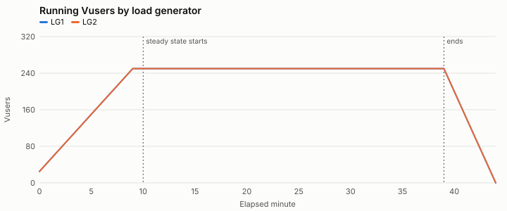
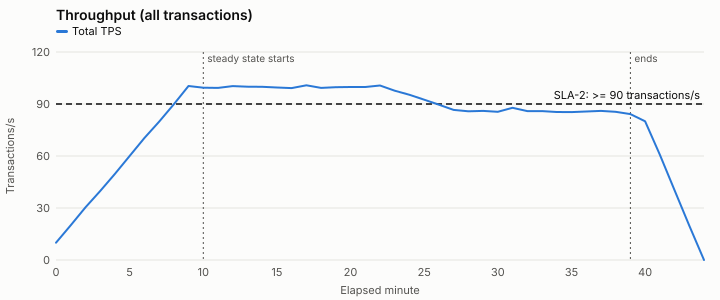
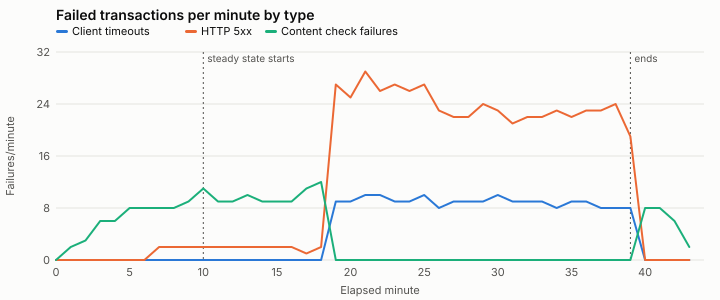

# Computed results summary — SYN-RUN-002

Generated by `tools/analyze.py (deterministic; no AI model involved)`. Every number here is calculated from the raw data files.

**Test objective:** Can the checkout journey support 500 concurrent users at 90+ transactions/second with checkout p95 at or under 2.0 seconds?

**Windows:** min 0-9, min 10-18, min 19-39, min 40-44 — Default windows: planned ramp-up, steady state split at the first minute any SLA fails, and ramp-down.

## Test run overview

| Item | Value |
| --- | --- |
| Test type | load |
| Build under test | syn-shop 4.13.0 |
| Changes since baseline | search ranking update, front-end bundle changes |
| Baseline run | SYN-RUN-000 (build 4.12.0) |
| Environment parity: app tier | 2 app nodes; production runs 6 of the same size (one-third scale) |
| Environment parity: database | production-size copy, refreshed 2026-09-15; same instance class as production |
| Environment parity: payment provider | shared third-party sandbox; production uses the provider's live service |
| Environment parity: cache | warmed by a 10-minute ramp-up; no separate warm-up run |
| Runtime setting: think time | fixed 3 s before each step |
| Runtime setting: pacing | fixed 20 s |
| Runtime setting: client timeout s | 30 |
| Runtime setting: abort on error | True |
| LG1 | 4 vCPU, log level standard |
| LG2 | 4 vCPU, log level standard |
| Script | checkout_journey v1.8: every step checks for expected page text; correlation validated in a single-Vuser run on 2026-09-30 |
| Test data: customers | SYN-CUST-50K (50,000 accounts, reused across iterations) |
| Test data: products | SYN-SKU-5K (5,000 in-stock SKUs) |

## Transaction summary (steady state)

From `transaction_summary.csv`, the load tool's run-level summary. Response times are for passed transactions, in seconds.

| Load generator | Transaction | Count | Passed | Failed | Error % | Min | Avg | p90 | p95 | p99 | Max | Std dev |
| --- | --- | --- | --- | --- | --- | --- | --- | --- | --- | --- | --- | --- |
| LG1 | search | 41981 | 41782 | 199 | 0.47 | 0.15 | 1.63 | 3.08 | 3.59 | 4.74 | 9.17 | 1.06 |
| LG1 | add_to_cart | 20821 | 20721 | 100 | 0.48 | 0.12 | 1.34 | 2.64 | 3.09 | 4.06 | 7.60 | 0.95 |
| LG1 | checkout | 20847 | 20748 | 99 | 0.47 | 0.22 | 2.91 | 5.36 | 6.24 | 8.10 | 16.82 | 1.89 |
| LG2 | search | 41809 | 41608 | 201 | 0.48 | 0.15 | 1.63 | 3.08 | 3.60 | 4.75 | 9.69 | 1.07 |
| LG2 | add_to_cart | 20962 | 20867 | 95 | 0.45 | 0.11 | 1.33 | 2.62 | 3.06 | 4.00 | 7.77 | 0.94 |
| LG2 | checkout | 20884 | 20784 | 100 | 0.48 | 0.23 | 2.95 | 5.43 | 6.33 | 8.24 | 15.65 | 1.93 |
| ALL | search | 83790 | 83390 | 400 | 0.48 | 0.15 | 1.63 | 3.08 | 3.60 | 4.74 | 9.69 | 1.07 |
| ALL | add_to_cart | 41783 | 41588 | 195 | 0.47 | 0.11 | 1.34 | 2.63 | 3.07 | 4.03 | 7.77 | 0.95 |
| ALL | checkout | 41731 | 41532 | 199 | 0.48 | 0.22 | 2.93 | 5.40 | 6.28 | 8.19 | 16.82 | 1.91 |

## Graphs

## Baseline comparison: SYN-RUN-000 (build 4.12.0)

Compares this run with the baseline run. Baseline data is never used to fill gaps in this run. A transaction is flagged when p90 or p95 is more than 10% slower than the baseline.

Steady-state throughput: 92.9 TPS against 100.1 TPS in the baseline (-7.2%).

| Transaction | Avg (base → now) | p90 (base → now) | p95 (base → now) | p99 (base → now) | Error % (base → now) | Regression |
| --- | --- | --- | --- | --- | --- | --- |
| search | 0.6 → 1.63 (+171.7%) | 0.89 → 3.08 (+246.1%) | 1.01 → 3.6 (+256.4%) | 1.28 → 4.74 (+270.3%) | 0.2 → 0.48 | YES |
| add_to_cart | 0.4 → 1.34 (+235.0%) | 0.59 → 2.63 (+345.8%) | 0.67 → 3.07 (+358.2%) | 0.86 → 4.03 (+368.6%) | 0.19 → 0.47 | YES |
| checkout | 0.85 → 2.93 (+244.7%) | 1.25 → 5.4 (+332.0%) | 1.42 → 6.28 (+342.3%) | 1.81 → 8.19 (+352.5%) | 0.21 → 0.48 | YES |

## Errors by type

| Window | Load generator | Transactions | Failed | Client timeouts | HTTP 5xx | Content check failures |
| --- | --- | --- | --- | --- | --- | --- |
| min 0-9 | LG1 | 16480 | 31 | 0 | 3 | 28 |
| min 0-9 | LG2 | 16545 | 33 | 0 | 3 | 30 |
| min 10-18 | LG1 | 26960 | 56 | 0 | 9 | 47 |
| min 10-18 | LG2 | 26907 | 50 | 0 | 8 | 42 |
| min 19-39 | LG1 | 56689 | 342 | 93 | 249 | 0 |
| min 19-39 | LG2 | 56748 | 346 | 95 | 251 | 0 |
| min 40-44 | LG1 | 6021 | 12 | 0 | 0 | 12 |
| min 40-44 | LG2 | 6035 | 12 | 0 | 0 | 12 |

## SLA results (steady state)

First failing minute: 19. Steady-state error rate: 0.47%.
SLA-1 is judged per generator per minute because p95 values cannot be averaged.

| Min | Checkout p95 by generator | SLA-1 | TPS | SLA-2 | Error % | SLA-3 |
| --- | --- | --- | --- | --- | --- | --- |
| 10 | LG1 1.45, LG2 1.36 | PASS | 99.4 | PASS | 0.22 | PASS |
| 11 | LG1 1.41, LG2 1.4 | PASS | 99.3 | PASS | 0.18 | PASS |
| 12 | LG1 1.38, LG2 1.37 | PASS | 100.3 | PASS | 0.18 | PASS |
| 13 | LG1 1.34, LG2 1.39 | PASS | 100.0 | PASS | 0.2 | PASS |
| 14 | LG1 1.54, LG2 1.43 | PASS | 99.9 | PASS | 0.18 | PASS |
| 15 | LG1 1.39, LG2 1.42 | PASS | 99.5 | PASS | 0.18 | PASS |
| 16 | LG1 1.36, LG2 1.42 | PASS | 99.2 | PASS | 0.18 | PASS |
| 17 | LG1 1.41, LG2 1.52 | PASS | 100.8 | PASS | 0.2 | PASS |
| 18 | LG1 1.5, LG2 1.46 | PASS | 99.3 | PASS | 0.23 | PASS |
| 19 | LG1 5.07, LG2 5.08 | FAIL | 99.7 | PASS | 0.6 | PASS |
| 20 | LG1 4.79, LG2 5.06 | FAIL | 99.8 | PASS | 0.57 | PASS |
| 21 | LG1 5.24, LG2 5.33 | FAIL | 99.8 | PASS | 0.65 | PASS |
| 22 | LG1 6.05, LG2 5.68 | FAIL | 100.7 | PASS | 0.6 | PASS |
| 23 | LG1 5.78, LG2 6.08 | FAIL | 97.7 | PASS | 0.61 | PASS |
| 24 | LG1 5.88, LG2 5.64 | FAIL | 95.3 | PASS | 0.61 | PASS |
| 25 | LG1 6.29, LG2 6.52 | FAIL | 92.5 | PASS | 0.67 | PASS |
| 26 | LG1 6.37, LG2 7.26 | FAIL | 89.6 | FAIL | 0.58 | PASS |
| 27 | LG1 7.19, LG2 7.34 | FAIL | 86.6 | FAIL | 0.6 | PASS |
| 28 | LG1 6.35, LG2 6.85 | FAIL | 85.8 | FAIL | 0.6 | PASS |
| 29 | LG1 7.39, LG2 6.79 | FAIL | 86.0 | FAIL | 0.64 | PASS |
| 30 | LG1 7.29, LG2 6.76 | FAIL | 85.5 | FAIL | 0.64 | PASS |
| 31 | LG1 6.59, LG2 6.91 | FAIL | 87.8 | FAIL | 0.57 | PASS |
| 32 | LG1 7.23, LG2 7.01 | FAIL | 85.9 | FAIL | 0.6 | PASS |
| 33 | LG1 7.28, LG2 7.64 | FAIL | 85.9 | FAIL | 0.6 | PASS |
| 34 | LG1 6.89, LG2 7.67 | FAIL | 85.4 | FAIL | 0.6 | PASS |
| 35 | LG1 6.99, LG2 7.55 | FAIL | 85.3 | FAIL | 0.61 | PASS |
| 36 | LG1 7.2, LG2 7.41 | FAIL | 85.7 | FAIL | 0.62 | PASS |
| 37 | LG1 6.84, LG2 7.28 | FAIL | 86.0 | FAIL | 0.6 | PASS |
| 38 | LG1 7.18, LG2 7.41 | FAIL | 85.5 | FAIL | 0.62 | PASS |
| 39 | LG1 7.43, LG2 7.45 | FAIL | 84.2 | FAIL | 0.53 | PASS |
